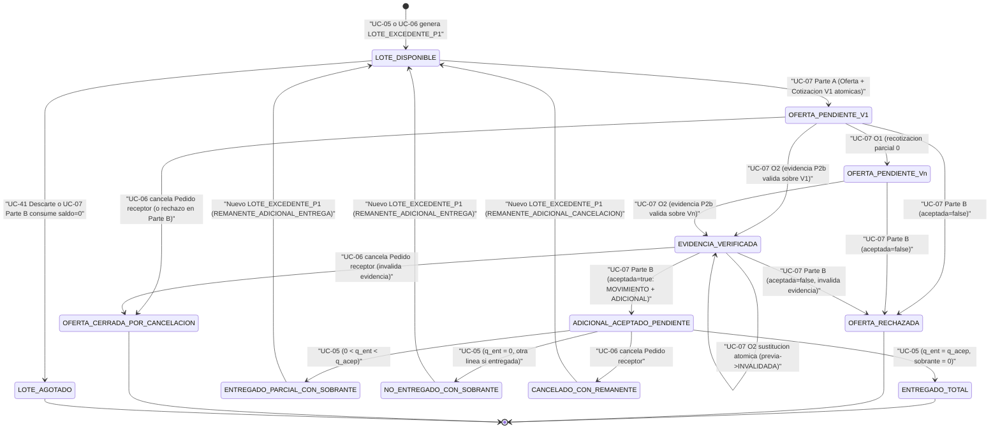

# Propuesta Técnica R04–R07 / UC-07 — Modelo Aditivo P1, Seguridad F8, Preflight G, Concurrencia H e Interfaz `IC-UC07-GFIS-02`

- **Proyecto:** Sistema de Gestión para Ale Milanesas
- **Fecha de elaboración:** 21/11/2026 (UTC−03, Argentina)
- **Traspaso ejecutado:** Codex → Antigravity (continuación y cierre del encargo documental P1/F8/G/H interrumpido por agotamiento de crédito de Codex)
- **Orquestación:** ChatGPT · **Autoridad comercial y de integración:** Responsable del proyecto (`leandrito369`)
- **Repositorio de escritura único:** `leandrito369/ale-milanesas` (Gobierno) · **Repositorio de aplicación (`leandrito369/ale-milanesas-app`):** solo lectura
- **Estado normativo/técnico:** `PROPUESTO` (expediente documental DRAFT para revisión; **NO RATIFICADO**, **NO INTEGRADO**, **NO PROBADO EN RUNTIME**, **NO ACEPTADO HUMANAMENTE**, **NO DESPLEGADO**)

> [!IMPORTANT]
> **Alcance negativo y fronteras de autoridad:** Este documento no constituye una Resolución de Decisión (RD) aprobada, no modifica contratos canónicos G0 ni `source-lock.md`, no edita las PR `#47`, `#48`, `#68`, `#74` ni `#101`, no promueve `V4` ni crea migraciones Flyway, no altera `src/main/**`, no habilita feature flags, no modifica la Demo ni reactiva el despliegue (`leandrito369/ale-milanesas-app#28` permanece bajo pausa operativa). Todo fragmento SQL incluido es **DDL ilustrativo propuesto, NO ejecutado**. Se preserva `S10 = NO ACREDITADO` (limitación histórica de procedencia de G-ARQ Nivel 1).

---

## Convención obligatoria de estados

A lo largo de los doce entregables (`E-P1-01` a `E-P1-12`) se distinguen estrictamente seis estados no intercambiables:

`PROPUESTO` → `RATIFICADO` → `INTEGRADO` → `PROBADO` → `ACEPTADO HUMANAMENTE` → `DESPLEGADO`

Ningún estado implica automáticamente el siguiente. En particular:
- Las decisiones comerciales `RCG-01..08` (`ACTA_G_COM_001`) y las decisiones `A–C` (y `D–E` en su alcance funcional) están `RATIFICADO` / `INTEGRADO` documentalmente, pero **no** `PROBADO` físicamente en un servicio `UC-07` final.
- Las siete decisiones de fronteras `A/B` de `R08.6 / G-FIS` (`A1`, `FA-1`, `FA-2`, `B1`, `Alternativa A`, `B1-R1`, `B1-R2`) fueron **ratificadas expresamente por el responsable el 21/11/2026** en [leandrito369/ale-milanesas-app#101 (comentario 7064807213)](https://github.com/leandrito369/ale-milanesas-app/pull/101#issuecomment-7064807213), pero su **RD formal aún NO está integrada en Gobierno `main`** y `B1-R1` aún **NO** está implementada ni probada en el laboratorio `#101`. Dicha ratificación **no** aprueba `P1`/`P2`, `F8`, `G`, `H`, `V4`, `G-FIS Fase C` ni `G-DEV/R09.1`.

---

## 1. `E-P1-01` — Acta de recuperación y preflight (M0)

- **Fuentes consultadas:** `git status`, `git branch -avv`, `git stash list`, `git worktree list`, `git log`, `git fetch origin --prune`, API GitHub de `leandrito369/ale-milanesas` y `leandrito369/ale-milanesas-app`, [PR #74](https://github.com/leandrito369/ale-milanesas/pull/74) (`9d43fa1b97dccd00a060e97c26ebf289e9851d84`), [comentario 7064807213 en app #101](https://github.com/leandrito369/ale-milanesas-app/pull/101#issuecomment-7064807213).
- **Resultado:** Preflight completo y verificado; recuperación íntegra de PR `#74` (auditoría previa de Codex) y constatación forense de ausencia de rama/borrador local o remoto del encargo interrumpido P1/F8/G/H.
- **Alcance de validación:** Inspección Git/GitHub de metadatos, refs, árboles de trabajo y documentos; **no** se accedió a la máquina cloud previa de Codex ni a bases de datos de producción/destino.
- **Estado normativo/técnico:** `PROPUESTO` (evidencia verificada de preflight M0 al 21/11/2026).

### 1.1 Qué dejó Codex y qué pudo recuperarse realmente

| Comprobación M0 | Resultado verificado (21/11/2026) | Interpretación honesta |
|---|---|---|
| Rama/PR previa de Codex | Encontrada y recuperada íntegramente en modo lectura: `origin/docs/r04-r07-auditoria-uc07-cr-h-2026-11-20` → [PR #74 DRAFT](https://github.com/leandrito369/ale-milanesas/pull/74), HEAD `9d43fa1b97dccd00a060e97c26ebf289e9851d84` (`docs/01-gobierno/b0/AUDITORIA_R04_R07_CR_C_CR_F_H_2026-11-20.md`, 467 líneas, CI B0 [run 44909047810](https://github.com/leandrito369/ale-milanesas/actions/runs/44909047810) `SUCCESS`, SonarCloud Quality Gate `Passed`, 0 issues nuevas). | Reutilizable en lectura por SHA inmutable como base diagnóstica (`CX-01..CX-09`, `E-CX-01..10`, `IC-UC07-GFIS-01`). **No** se ramifica desde `#74` ni se la da por integrada. |
| Ramas locales, stashes, worktrees o archivos sin commit del encargo P1 interrumpido | En `/home/lean/ale-milanesas`: `main` limpio en `e3f4ee5a752b29329117c7bb097e2a851ea60ca5`; `git stash list` vacío; único worktree auxiliar `/home/lean/ale-milanesas-wt-pr43` (`d4279c2`, histórico del 08/11/2026); **0 ramas locales ni remotas** para el encargo P1/F8/G/H; **0 borradores** en disco. | El encargo P1 de Codex se ejecutó en un entorno cloud distinto e inaccesible desde este workspace (corroborado además porque el cuerpo de PR `#74` cita un checkout local propio de app en `5cd64623f2fae7bbe44ee16b587a7ebd308f51f9`, distinto de este host). **No se afirma haber recuperado archivos inexistentes.** |
| Rama nueva creada para continuar | `docs/r04-r07-p1-aditivos-f8-g-h-2026-11-21` creada limpiamente desde `origin/main` (`e3f4ee5a752b29329117c7bb097e2a851ea60ca5`). | Aislamiento total respecto de `#74`, `#47`, `#48`, `#68` y `#101`. |
| Repositorio de aplicación (`/home/lean/ale-milanesas-app`) | Árbol limpio en solo lectura; `origin/main` verificado en `21db1f536d0d7153e5d4abb721115778dadf14b3`; PR `#101` intacta en `4c2839f2be5d6be6abcb5f95d30579b9838fca1e`. | **0 cambios** en `ale-milanesas-app`. |

### 1.2 Línea base exacta de SHAs y estados al 21/11/2026

| Artefacto / Referencia | Repositorio | SHA verificado | Estado real |
|---|---|---|---|
| `main` (base de esta rama) | `ale-milanesas` | `e3f4ee5a752b29329117c7bb097e2a851ea60ca5` | `INTEGRADO` (incluye `#64`, `#65`, `#66`, `#67`, `#70`, `#71`, `#72`, `#73`) |
| `main` (solo lectura) | `ale-milanesas-app` | `21db1f536d0d7153e5d4abb721115778dadf14b3` | `INTEGRADO` (V1–V3, 62 tablas; `#85`, `#86`, `#91` integrados) |
| PR `#74` (Auditoría Codex) | `ale-milanesas` | `9d43fa1b97dccd00a060e97c26ebf289e9851d84` | `OPEN / DRAFT` (solo lectura, no editada) |
| PR `#47` (`CR-B0-UC07-001`, CR-C) | `ale-milanesas` | `9c0a54e4a2147f5f048f7827f26a21b1bfeecf1b` | `OPEN / DRAFT` (solo lectura, no editada) |
| PR `#48` (`CR-B0-UC07-002`, CR-F) | `ale-milanesas` | `fda51c929258dc42e71c40c95bbcd89d0324c306` | `OPEN / DRAFT` (solo lectura, no editada) |
| PR `#68` (`R08.6` Puerta 1) | `ale-milanesas` | `c7e1b14d0925022158920de7dc26124aa5f1707f` | `OPEN / DRAFT` (solo lectura, no editada) |
| PR `#89` (`C3-A.3` Nivel R/P) | `ale-milanesas-app` | `642abd6541f0e358d1f9124d7d80bb49234faa14` | `OPEN / DRAFT` (solo lectura, antecedente parcial H) |
| PR `#101` (Laboratorio G-FIS) | `ale-milanesas-app` | `4c2839f2be5d6be6abcb5f95d30579b9838fca1e` | `OPEN / DRAFT` (solo lectura, **NO tocada**; 752/752 B1/B2 reportados en comentario `7064807213`) |
| Constancia ratificación A/B (21/11) | `ale-milanesas-app` | Comentario `7064807213` en `#101` | `RATIFICADO` por responsable (RD aún **NO integrada** en Gobierno `main`; `B1-R1` pendiente de lab) |
| G0 `source-lock` | `ale-milanesas` | `source=1263ffc17bd0eb7f3c69faaa9ff5ae556cf9de7e`, `gov=27738b089afdd2698cdae915f75c0e8089a6248a` | Línea base inmutable (64 CU / 67 operaciones, RBAC 67×8, BC07 15 proyecciones) |

### 1.3 Novedad normativa del 21/11/2026 (fronteras A/B de G-FIS) y su separación respecto de UC-07

El 21/11/2026 (`15:21:10Z`), el responsable registró en [app#101#issuecomment-7064807213](https://github.com/leandrito369/ale-milanesas-app/pull/101#issuecomment-7064807213) la ratificación expresa de siete reglas del carril G-FIS:
1. **`A1`:** Recorrido explícito y pertenencia verificable del Pedido antes de `ENTREGA`; `UC-43` sigue reservado a `VENDEDOR`.
2. **`FA-1`:** Máximo un Recorrido `ABIERTO` por Repartidor.
3. **`FA-2`:** Prohibido cerrar o iniciar cierre con Pedidos `PENDIENTE` activos sin resolver.
4. **`B1`:** `PENDIENTE_CONCILIACION` genera cero Cobros, cero Caja y cero extinción de `V_e^{vig}`; confirmación financiera definitiva en una única transacción `T1-C2` con controles `K2`.
5. **`Alternativa A`:** Rectificación versionada append-only mediante `REVISION_CONCILIACION_PE2`, una cabecera única por Recorrido.
6. **`B1-R1`:** Una rectificación acreditada con `faltante = 0` y `custodia = 0` habilita cierre `CONFIRMADO` sin duplicar efectos (**requiere adaptación y pruebas adicionales en laboratorio G-FIS; no implementada en `4c2839f2`**).
7. **`B1-R2`:** `INVALIDADA` mantiene el Recorrido en conciliación pendiente sin revisión vigente ni reapertura/reasignación automática; requiere revisión sucesora válida.

**Frontera estricta:** Estas siete reglas se incorporan como **contexto de compatibilidad obligatorio** para `IC-UC07-GFIS-02` (§9) y el grafo `H` (§8), **sin** revotarlas, **sin** declarar una RD formal ya integrada en Gobierno `main`, **sin** atribuir implementación a `B1-R1` y **sin** extender esa ratificación a `P1`/`P2`, `F8`, `G` o `H` de `UC-07`.

---

## 2. `E-P1-02` — Comparación técnica y justificación: P1 vs P2

- **Fuentes consultadas:** `ACTA_G_COM_001` (`RCG-02`), `ADENDA_REV04B_E01_E02_E03`, `V1__baseline_mr5.sql` (líneas 138–291, 914–924, 1274–1283, 1678–1688), PR `#74` §4 (`CX-01`, `CX-04`), CR-C `#47` §13.1, CR-F `#48` §§15.9–15.12, servicios `CargarPedidoService`, `BuscarPedidoService` y `RegistrarPreparacionService` en `ale-milanesas-app@21db1f53`.
- **Resultado:** Selección técnica recomendada de **P1 (subvariante estrictamente aditiva P1-A: persistencia aditiva de lote de excedente, oferta, versión, evidencia, adicional aceptado, atribución de entrega y resolución de cancelación/remanente, con cero relajación de restricciones V1)** frente a **P1-B** (evolución `ALTER COLUMN` de `EXCEDENTE`), **P2** (entidad unificada de componentes comerciales con puente legado) y las ya descartadas **P3** (recorte parcial solo a productos ya presentes) y **P4** (línea técnica `DETALLE_PEDIDO(cantidadOriginal=0)`).
- **Alcance de validación:** Análisis estructural de DDL `V1–V3`, contratos `REV04B`, `RCG-02` y consumidores Java actuales; **sin** ejecución DDL ni migración física.
- **Estado normativo/técnico:** `PROPUESTO` (requiere ratificación arquitectónica y posterior CR física dedicada antes de laboratorio UC-07).

### 2.1 Por qué falla la aproximación anterior (`CR-F §15.12` / P4) y por qué una simple tabla de entrega adicional tampoco basta

La auditoría de Codex ([PR #74](https://github.com/leandrito369/ale-milanesas/pull/74), `CX-01` y `CX-04`) demostró dos bloqueos independientes:

1. **Bloqueo contractual (`RCG-02` §2.3):** Aunque `V1` `ck_detalle_pedido_1/3` toleraba `cantidadOriginal = 0` (con `precioUnitarioOriginal IS NULL`), la cláusula ratificada `RCG-02` **prohíbe expresamente** resolver adicionales mediante `DETALLE_PEDIDO(cantidadOriginal = 0)`, desactivar `tg_mr3_validar_producto_detalle_nuevo`, editar `V1` o relajar `uq_detalle_pedido_0(idPedido, idProducto)`.
2. **Bloqueo estructural de ciclo completo (`fk_excedente_0`, `fk_oferta_excedente_0`, `fk_detalle_entrega_1`, `fk_imputacion_entrega_adicional_0`):**
   - `DETALLE_ENTREGA` exige `fk_detalle_entrega_1(idPedido, numeroDetalle) -> DETALLE_PEDIDO`.
   - `IMPUTACION_ENTREGA_ADICIONAL` exige `fk_imputacion_entrega_adicional_0(idPedido, numeroDetalle) -> DETALLE_ENTREGA`.
   - **`EXCEDENTE` (V1)** exige `fk_excedente_0(idPedidoOrigen, numeroDetalleOrigen) -> DETALLE_PEDIDO` con **ambas columnas `NOT NULL`** (y `OFERTA_EXCEDENTE`/`MOVIMIENTO_EXCEDENTE` tienen FK obligatoria a `EXCEDENTE`).
   - **Consecuencia crítica:** Si un Pedido receptor `P2` acepta un adicional de un `Producto X` **que no existía en su `DETALLE_PEDIDO` original**, y luego `P2` sufre una **entrega parcial** (dejando un remanente físico) o una **cancelación (`UC-06`)**, ese remanente debe convertirse en un nuevo Excedente disponible atribuido a `P2`, consultable en `UC-61`, re-ofertable en `UC-07` y descartable en `UC-41`. Una tabla aislada de entrega adicional resolvería solo `UC-05`, pero **quedaría bloqueada al generar el nuevo Excedente en `UC-05`/`UC-06`** porque `P2` no posee `(idPedidoOrigen=P2, numeroDetalleOrigen)` en `DETALLE_PEDIDO`, y falsear `idPedidoOrigen = P1` (pedido donante previo) corrompería la procedencia auditada.

### 2.2 Matriz comparativa P1 (P1-A vs P1-B) frente a P2

| Dimensión | **P1-A — Modelo aditivo estricto (RECOMENDADO)** | P1-B — Aditivo con `ALTER` sobre `EXCEDENTE` | **P2 — Componentes comerciales unificados + puente legado** |
|---|---|---|---|
| **Criterio central** | Nuevas tablas aditivas (`LOTE_EXCEDENTE_P1`, `OFERTA_EXCEDENTE_P1`, `COTIZACION_OFERTA_P1`, `EVIDENCIA_ACEPTACION_P1`, `EVENTO_ESTADO_EVIDENCIA_P1`, `COMANDO_AUXILIAR_UC07_P1`, `MOVIMIENTO_EXCEDENTE_P1`, `ADICIONAL_PEDIDO_ACEPTADO`, `ATRIBUCION_ENTREGA_ADICIONAL_P1`, `RESOLUCION_CANCELACION_ADICIONAL_P1`). V1–V3 **0% modificadas ni relajadas**. | Nuevas tablas de aceptación/entrega/cancelación, pero en `V5` hace `EXCEDENTE.numeroDetalleOrigen` nullable (`DROP NOT NULL`) manteniendo `fk_excedente_0 MATCH SIMPLE` + XOR con `ADICIONAL_PEDIDO_ACEPTADO`. | Nueva entidad unificada `COMPONENTE_COMERCIAL_PEDIDO` (tipo `ORIGINAL` \| `ADICIONAL_UC07`) y `COMPONENTE_ENTREGADO` con puente bidireccional hacia `DETALLE_PEDIDO`/`DETALLE_ENTREGA` V1. |
| **Cumplimiento `RCG-02` §2.3 (cero `DETALLE_PEDIDO` ficticio y cero relajación V1)** | **100% estricto.** Cero escrituras UC-07 en `DETALLE_PEDIDO`; cero `ALTER`/`DROP` de `NOT NULL`, `CHECK`, `UNIQUE`, `FK` o triggers V1. | Cumple prohibición de línea ficticia, **pero relaja `NOT NULL`** de `EXCEDENTE.numeroDetalleOrigen` (columna V1). | Cumple prohibición de línea ficticia, pero duplica la representación de líneas originales ya persistidas en `DETALLE_PEDIDO`/`DETALLE_ENTREGA`. |
| **Ciclo completo (oferta, aceptación, entrega parcial, sobrante, cancelación, 2.ª/N-ésima reasignación, descarte)** | **100% resuelto** para 1.ª, 2.ª y N-ésima generación de excedentes sin inventar `numeroDetalle` ni atribuir al donante anterior. | **100% resuelto**, con menor cantidad de tablas espejo en `EXCEDENTE`/`OFERTA_EXCEDENTE`, a costa de relajar V1 y acoplar políticas legacy/nuevas en la misma tabla. | **100% resuelto**, pero obliga a adaptar todos los servicios de originales (`UC-03`, `UC-28`, `UC-34`, `UC-05` originales) para sincronizar el puente legado. |
| **Impacto sobre código ya integrado en `app main` (`UC-03`, `UC-28`, `UC-34`, `V1–V3`)** | **Mínimo y aislado.** `CargarPedidoService`, `RegistrarPreparacionService` y `BuscarPedidoService` conservan `DETALLE_PEDIDO` exclusivo de originales; `BuscarPedidoService` solo añade lectura aditiva de `ADICIONAL_PEDIDO_ACEPTADO` al derivar `totalVigente`. | Bajo en `UC-03`/`UC-28`, medio en lectores de `EXCEDENTE` que asumen `numeroDetalleOrigen IS NOT NULL`. | **Alto.** Exige modificar `UC-03`, `UC-28`, `UC-34` y el corte inicial de `UC-05` (R09.1–R09.3) o mantener triggers de doble escritura entre `DETALLE_PEDIDO` y `COMPONENTE_COMERCIAL_PEDIDO`. |
| **Riesgo de doble autoridad / doble cargo / doble consumo** | Controlado por diseño: `LOTE_EXCEDENTE_P1` tiene `UNIQUE(idExcedenteV1)` (espejo 1:1 sincronizado en la misma TX para gen-1) y bloqueo de escritura directa legado tras cutover; `ATRIBUCION_ENTREGA_ADICIONAL_P1` tiene `UNIQUE(idAdicionalPedido)` + guardia cruzada frente a `IMPUTACION_ENTREGA_ADICIONAL`. | Menor cantidad de espejos (una sola tabla `EXCEDENTE`), pero requiere guardia estricta en `EXCEDENTE` para que ningún lector viejo ignore `tipoProcedencia`. | **Alto durante la coexistencia** del puente legado: riesgo de divergencia entre `DETALLE_PEDIDO`/`DETALLE_ENTREGA` y la tabla unificada si un escritor omite sincronizar el puente. |
| **Alineación con G-FIS (`PR #101`, `PE-1`, `IMP-B`, `T1-C2/K2`)** | **Óptima.** `RECONOCIMIENTO_ENTREGA_PE1` sigue recibiendo un único `cargoRealCe = C_e^{orig} + C_e^{adic}` sin alterar `DETALLE_ENTREGA` ni las 13 tablas candidatas de `#101`. | Compatible con `PE-1`/`IMP-B`, misma interfaz `IC-UC07-GFIS-02`. | Compatible a nivel de `PE-1`, pero retrasa R09.1–R09.3 si exige rehacer la persistencia de originales antes o durante R09.4. |
| **Compatibilidad con `B02` (eliminar `GRANT UPDATE(idProducto)`)** | **Resuelto de raíz:** UC-07 nunca dispara `tg_mr3_validar_producto_detalle_nuevo`; el bloqueo sobre `PRODUCTO` en Parte A pasa por función `SECURITY DEFINER` dedicada sin `UPDATE` sobre `PRODUCTO`. | Igual que P1-A. | Igual que P1-A, pero amplía la superficie ACL del puente sobre `DETALLE_PEDIDO`. |
| **Complejidad de migración / cutover (`G`)** | **Media, determinista y reversible:** ruta vacía (tablas P1 nuevas + secuencias sembradas > `MAX` V1) o ruta legado controlada sin mutar filas históricas V1. | Media-alta: requiere `ALTER TABLE` con `ACCESS EXCLUSIVE` sobre tabla V1 `EXCEDENTE` y ajuste de consumidores que proyectan `numeroDetalleOrigen NOT NULL`. | **Alta:** exige backfill de todo el historial de `DETALLE_PEDIDO` y `DETALLE_ENTREGA` (o vistas complejas de unión con dos esquemas de clave) + alto riesgo de regresión en R09.1–R09.3. |

### 2.3 Justificación de la decisión recomendada (`P1-A`)

1. **Preserva íntegro el contrato `RCG-02` y la inmutabilidad de `V1–V3`:** Ninguna restricción V1 (`fk_excedente_0`, `fk_detalle_entrega_1`, `fk_imputacion_entrega_adicional_0`, `uq_detalle_pedido_0`, `uq_movimiento_excedente_0`, `uq_imputacion_entrega_adicional_0`, `NOT NULL` ni triggers MR3/MR5) se elimina, debilita ni reescribe.
2. **No bloquea ni retrasa el carril `R09.1–R09.3` (originales + G-FIS):** Al mantener `DETALLE_PEDIDO` y `DETALLE_ENTREGA` 100% exclusivos de originales, el primer incremento online de `UC-05` avanza sin rediseño previo y `R09.4` se acopla de forma estrictamente aditiva mediante `IC-UC07-GFIS-02`.
3. **Resuelve la genealogía completa de excedentes (N saltos):** Tanto un sobrante de entrega original (generación 1) como un sobrante de entrega parcial de adicional o de cancelación de pedido receptor (generación 2, 3, ..., N) comparten una única entidad canónica `LOTE_EXCEDENTE_P1` con procedencia exacta, costo histórico exacto y conservación matemática verificable.
4. **Mantiene intactas las firmas G0:** Las operaciones `buscarExcedente` (`UC-61`), `registrarOfertaExcedente` (`UC-07` Parte A), `registrarRespuestaOfertaExcedente` (`UC-07` Parte B) y `registrarDescarteExcedente` (`UC-41`) preservan exactamente sus firmas G0 (`idExcedente: Long`, `idOfertaExcedente: Long`) sin introducir nuevos CU principales ni alterar la matriz RBAC `67×8`.

*(Nota de gobierno: si al evaluar la futura CR física el responsable prefiriera **P1-B** para evitar la capa espejo `LOTE_EXCEDENTE_P1`/`OFERTA_EXCEDENTE_P1` sobre `EXCEDENTE`/`OFERTA_EXCEDENTE`, ello requeriría una dispensa explícita documentada para ejecutar `ALTER TABLE "EXCEDENTE" ALTER COLUMN "numeroDetalleOrigen" DROP NOT NULL` en `V5`. Mientras no exista tal autorización expresa, **P1-A** es la única variante que cumple simultáneamente el ciclo completo y cero relajación de restricciones V1.)*

---

## 3. `E-P1-03` — Modelo conceptual/relacional y máquina de estados del ciclo adicional completo (P1-A)

- **Fuentes consultadas:** `CONTRATOS_REV04B_CORREGIDOS_B0_ACTUALIZADO.md` (`UC-05`, `UC-06`, `UC-07`, `UC-41`, `UC-61`), `RD_UC07_001`, `RD_UC07_002`, `ACTA_G_COM_001` (`RCG-01..08`), `CR-C #47`, `CR-F #48`, `V1__baseline_mr5.sql`, `G_ARQ_N2_02`.
- **Resultado:** Especificación completa de las 10 entidades aditivas P1-A, identificadores/cardinalidades, claves candidatas, atributos inmutables, máquina de estados, fronteras transaccionales, responsables de escritura, recuperación/rollback y cobertura verificada de los 13 hitos obligatorios del ciclo de vida.
- **Alcance de validación:** Diseño conceptual y relacional estático con DDL ilustrativo; **NO ejecutado** en PostgreSQL.
- **Estado normativo/técnico:** `PROPUESTO` (sujeto a aprobación arquitectónica y posterior CR física dedicada).

### 3.1 Entidades conceptuales y relaciones físicas candidatas (esquema efectivo `ale_gestion`)

Todas las entidades siguientes se ubican en el esquema configurado por la aplicación (`ale_gestion`, ver `application.yml` y §7), empleando generadores `B2-HÍBRIDO` (`SEQUENCE` para PK técnicas `BIGINT`; `UUID` generado en servidor para cotizaciones/evidencias/comandos; ordinales de negocio `numeroVersion` y `numeroIntentoEvidencia` asignados bajo bloqueo del agregado `OFERTA_EXCEDENTE_P1`).

| # | Entidad candidata P1-A | PK / Claves candidatas | Cardinalidad y FK principales | Inmutabilidad / Eventos auditables | Escritor autorizado |
|---|---|---|---|---|---|
| 1 | `LOTE_EXCEDENTE_P1` | PK `idLoteExcedente BIGINT` (`seq_uc07_lote_excedente`); `UQ(idExcedenteV1)` (nullable); `UQ(idAdicionalOrigen)` (nullable) | `FK(idExcedenteV1) -> EXCEDENTE` (si gen-1); `FK(idAdicionalOrigen) -> ADICIONAL_PEDIDO_ACEPTADO` (si gen-2+); `FK(idPedidoGenerador) -> PEDIDO`; `FK(idProducto) -> PRODUCTO`; `FK(codigoUnidadVenta) -> UNIDAD_MEDIDA` | Procedencia, producto, unidad, `cantidadInicial`, `costoHistoricoInicial`, `fechaHoraGeneracion` **inmutables**. Solo `cantidadDisponible` y `costoHistoricoDisponible` decrecen monótonamente mediante `MOVIMIENTO_EXCEDENTE_P1`. | Creación: `UC-05` / `UC-06`. Consumo: `UC-07` Parte B (`REASIGNACION`) / `UC-41` (`DESCARTE`). |
| 2 | `OFERTA_EXCEDENTE_P1` | PK `idOfertaExcedente BIGINT` (`seq_uc07_oferta_excedente`); `UQ(idOfertaExcedente, idLoteExcedente)`; `UQ(idOfertaExcedente, idPedidoReceptor)` | `FK(idLoteExcedente) -> LOTE_EXCEDENTE_P1`; `FK(idPedidoReceptor) -> PEDIDO`; `FK(idUsuarioVendedor) -> USUARIO`; `FK(idPrecioSnapshot) -> PRECIO_PRODUCTO` | `idLoteExcedente`, `idPedidoReceptor`, `idUsuarioVendedor`, `fechaHoraOferta`, `cantidadOfrecida`, `idPrecioSnapshot`, `precioBaseUnitarioAplicado`, `tipoAjusteAplicado`, `porcentajeAjusteAplicado`, `importeInformado` **inmutables**. Solo `respuesta` (`PENDIENTE -> ACEPTADA | RECHAZADA | CANCELADA_POR_PEDIDO`), `fechaHoraRespuesta`, `cantidadAceptada`, `importeAceptado` mutan una sola vez (terminales inmutables). | Creación: `UC-07` Parte A (`VENDEDOR`). Cierre: `UC-07` Parte B (`VENDEDOR`) o invalidación al cancelar receptor (`UC-06`, ver §3.4). |
| 3 | `COTIZACION_OFERTA_P1` | PK `idCotizacion UUID`; `UQ(idOfertaExcedente, numeroVersion)`; `UQ(idOfertaExcedente, idCotizacion)`; `UQ(codigoCotizacion)` (`CHAR(64)`, canonización `UC07-COT/1`) | `FK(idOfertaExcedente) -> OFERTA_EXCEDENTE_P1`; `FK(idPrecioAplicado) -> PRECIO_PRODUCTO`; `FK(idUsuarioEmisor) -> USUARIO` | **100% append-only inmutable** (sin columna de estado mutable; cero `UPDATE`/`DELETE`). V1 se crea atómicamente en Parte A con `cantidadCotizada = cantidadOfrecida`; V≥2 solo vía O1 con `0 < cantidadCotizada < cantidadOfrecida`. | V1: `UC-07` Parte A (`VENDEDOR`). V≥2: `UC-07` O1 (`VENDEDOR`). |
| 4 | `EVIDENCIA_ACEPTACION_P1` | PK `idEvidencia UUID`; `UQ(idOfertaExcedente, numeroIntentoEvidencia)`; `UQ(idOfertaExcedente, idEvidencia)`; índice único parcial `uq_ev_p1_vigente_o_usada(idOfertaExcedente) WHERE estadoEvidencia IN ('VERIFICADA','UTILIZADA')` | FK compuesta `(idOfertaExcedente, idCotizacion) -> COTIZACION_OFERTA_P1(idOfertaExcedente, idCotizacion)`; `FK(idUsuarioRegistrador) -> USUARIO` | `bytesOriginales BYTEA` (P2b PNG/JPEG), `sha256Archivo CHAR(64)`, `mimeDetectado`, `anchoPx`, `altoPx`, `tamanoBytes`, `declaracionTexto` (≥20 no-blancos), `fechaHoraMensajeCliente`, `numeroIntentoEvidencia` **inmutables**. Solo `estadoEvidencia` transita (`VERIFICADA -> INVALIDADA | UTILIZADA`), generando evento obligatorio en `EVENTO_ESTADO_EVIDENCIA_P1`. | Alta/sustitución: `UC-07` O2 (`VENDEDOR`). Consumo/invalidación: `UC-07` Parte B (`VENDEDOR`) o `UC-06`. |
| 5 | `EVENTO_ESTADO_EVIDENCIA_P1` | PK `idEvento BIGINT` (`seq_uc07_evento_evidencia`) | `FK(idEvidencia) -> EVIDENCIA_ACEPTACION_P1`; `FK(idUsuarioActor) -> USUARIO` | **100% append-only inmutable** (cero `UPDATE`/`DELETE`). Solo insertado por función/trigger `SECURITY DEFINER` tras transición real de `EVIDENCIA_ACEPTACION_P1`. | Interno controlado (`uc07_owner` vía trigger/función). |
| 6 | `COMANDO_AUXILIAR_UC07_P1` | PK `idComando UUID`; `UQ(operacion, idOfertaExcedente, idUsuarioVendedor, claveIdempotencia)` | `FK(idOfertaExcedente) -> OFERTA_EXCEDENTE_P1`; `FK(idUsuarioVendedor) -> USUARIO` | **100% append-only inmutable.** Guarda `huellaSolicitud CHAR(64)` (`UC07-IDEM/1`) y `reciboHistoricoJson JSONB` mínimo (sin PII ni secretos). `estadoActual` se consulta en vivo y **nunca** sobrescribe el recibo histórico (`RCG-05`). | `UC-07` O1, O2 y Parte B (`VENDEDOR`). |
| 7 | `MOVIMIENTO_EXCEDENTE_P1` | PK `idMovimientoExcedente BIGINT` (`seq_uc07_movimiento_excedente`); `UQ(idOfertaExcedente)` (nullable, preserva `uq_movimiento_excedente_0`) | `FK(idLoteExcedente) -> LOTE_EXCEDENTE_P1`; `FK(idOfertaExcedente, idLoteExcedente) -> OFERTA_EXCEDENTE_P1` (si `REASIGNACION`); `FK(idUsuarioOperador) -> USUARIO` | **100% append-only inmutable.** XOR estricto: `REASIGNACION` (`idOfertaExcedente NOT NULL`, `motivoDescarte IS NULL`) vs `DESCARTE` (`idOfertaExcedente IS NULL`, `motivoDescarte NOT NULL`). | `REASIGNACION`: `UC-07` Parte B (`VENDEDOR`). `DESCARTE`: `UC-41` (`RESPONSABLE_PRODUCCION`). |
| 8 | `ADICIONAL_PEDIDO_ACEPTADO` | PK `idAdicionalPedido BIGINT` (`seq_uc07_adicional_pedido`); `UQ(idOfertaExcedente)`; `UQ(idEvidenciaUtilizada)`; `UQ(idMovimientoExcedente)`; `UQ(idPedidoReceptor, idAdicionalPedido)` | `FK(idPedidoReceptor) -> PEDIDO`; `FK(idOfertaExcedente, idPedidoReceptor) -> OFERTA_EXCEDENTE_P1`; `FK(idOfertaExcedente, idCotizacionUtilizada) -> COTIZACION_OFERTA_P1`; `FK(idOfertaExcedente, idEvidenciaUtilizada) -> EVIDENCIA_ACEPTACION_P1`; `FK(idMovimientoExcedente) -> MOVIMIENTO_EXCEDENTE_P1`; `FK(idProducto) -> PRODUCTO`; `FK(idPrecioAplicado) -> PRECIO_PRODUCTO` | Snapshot completo (oferta, versión, evidencia, movimiento, producto, unidad, cantidad aceptada, precio/ajuste históricos, importe aceptado, costo histórico transferido) **100% inmutable**. Solo `estadoCiclo` transita exactamente una vez de `ACEPTADO_PENDIENTE` a un estado terminal en `UC-05` o `UC-06`. | Alta: `UC-07` Parte B (`VENDEDOR`). Cierre: `UC-05` (`REPARTIDOR`) o `UC-06` (`VENDEDOR` / `REPARTIDOR` asignado). |
| 9 | `ATRIBUCION_ENTREGA_ADICIONAL_P1` | PK `idAtribucionEntregaAdicional BIGINT` (`seq_uc07_atribucion_entrega`); `UQ(idAdicionalPedido)` (preserva `uq_imputacion_entrega_adicional_0`); `UQ(idLoteExcedenteSobrante)` (nullable) | `FK(idPedido) -> ENTREGA(idPedido)`; FK compuesta `(idPedido, idAdicionalPedido) -> ADICIONAL_PEDIDO_ACEPTADO(idPedidoReceptor, idAdicionalPedido)`; `FK(idLoteExcedenteSobrante) -> LOTE_EXCEDENTE_P1` (si `cantidadSobrante > 0`) | **100% append-only inmutable.** Verifica conservación exacta: `cantidadEntregada + cantidadSobrante = cantidadAceptada`, `costoHistoricoVendido + costoHistoricoSobrante = costoHistoricoTransferido`, `importeEntregado <= importeAceptado`. | `UC-05` (`REPARTIDOR` asignado), misma TX que `ENTREGA`, `RECONOCIMIENTO_ENTREGA_PE1` e `IMP-B`. |
| 10 | `RESOLUCION_CANCELACION_ADICIONAL_P1` | PK `idAdicionalPedido BIGINT`; `UQ(idLoteExcedenteRemanente)` | FK compuesta `(idPedido, idAdicionalPedido) -> ADICIONAL_PEDIDO_ACEPTADO(idPedidoReceptor, idAdicionalPedido)`; `FK(idLoteExcedenteRemanente) -> LOTE_EXCEDENTE_P1` | **100% append-only inmutable.** Garantiza exclusión mutua con `ATRIBUCION_ENTREGA_ADICIONAL_P1` y conservación 100% de cantidad y costo hacia `LOTE_EXCEDENTE_P1` (`origenGeneracion = 'CANCELACION'`). | `UC-06` (`VENDEDOR` o `REPARTIDOR` asignado), misma TX que `PEDIDO.estado = 'CANCELADO'` y liberación `IMP-B`. |

### 3.2 DDL ilustrativo propuesto (NO ejecutado, NO migración Flyway)

> **Advertencia:** El SQL siguiente es exclusivamente un **diseño relacional candidato ilustrativo** para evaluación arquitectónica de P1-A. No debe ejecutarse ni copiarse a `src/main/resources/db/migration/` sin autorización de CR física, resolución de `F8`, `G`, `H` y aprobación humana expresa.

```sql
-- =============================================================================
-- DDL ILUSTRATIVO PROPUESTO (P1-A) — NO EJECUTADO / NO MIGRACION FLYWAY
-- Esquema objetivo: ale_gestion (V1-V3 intactas; cero relajacion de FKs/CHECKs)
-- =============================================================================

CREATE TABLE ale_gestion."LOTE_EXCEDENTE_P1" (
    "idLoteExcedente"           BIGINT        NOT NULL,
    "tipoProcedencia"           VARCHAR(35)   NOT NULL,
    "idExcedenteV1"             BIGINT,
    "idAdicionalOrigen"         BIGINT,
    "idPedidoGenerador"         BIGINT        NOT NULL,
    "idProducto"                BIGINT        NOT NULL,
    "codigoUnidadVenta"         VARCHAR(20)   NOT NULL,
    "origenGeneracion"          VARCHAR(15)   NOT NULL,
    "fechaHoraGeneracion"       TIMESTAMPTZ   NOT NULL,
    "cantidadInicial"           NUMERIC(18,3) NOT NULL,
    "cantidadDisponible"        NUMERIC(18,3) NOT NULL,
    "costoHistoricoInicial"     NUMERIC(18,4) NOT NULL,
    "costoHistoricoDisponible"  NUMERIC(18,4) NOT NULL,
    CONSTRAINT "pk_lote_excedente_p1" PRIMARY KEY ("idLoteExcedente"),
    CONSTRAINT "uq_lote_exc_p1_v1" UNIQUE ("idExcedenteV1"),
    CONSTRAINT "uq_lote_exc_p1_adic_origen" UNIQUE ("idAdicionalOrigen"),
    CONSTRAINT "fk_lote_exc_p1_v1" FOREIGN KEY ("idExcedenteV1")
        REFERENCES ale_gestion."EXCEDENTE" ("idExcedente") ON UPDATE RESTRICT ON DELETE RESTRICT,
    CONSTRAINT "fk_lote_exc_p1_pedido" FOREIGN KEY ("idPedidoGenerador")
        REFERENCES ale_gestion."PEDIDO" ("idPedido") ON UPDATE RESTRICT ON DELETE RESTRICT,
    CONSTRAINT "fk_lote_exc_p1_producto" FOREIGN KEY ("idProducto")
        REFERENCES ale_gestion."PRODUCTO" ("idProducto") ON UPDATE RESTRICT ON DELETE RESTRICT,
    CONSTRAINT "fk_lote_exc_p1_unidad" FOREIGN KEY ("codigoUnidadVenta")
        REFERENCES ale_gestion."UNIDAD_MEDIDA" ("codigoUnidad") ON UPDATE RESTRICT ON DELETE RESTRICT,
    CONSTRAINT "ck_lote_exc_p1_origen" CHECK ("origenGeneracion" IN ('ENTREGA','CANCELACION')),
    CONSTRAINT "ck_lote_exc_p1_procedencia" CHECK (
        ("tipoProcedencia" = 'EXCEDENTE_ORIGINAL_V1'
            AND "idExcedenteV1" IS NOT NULL AND "idAdicionalOrigen" IS NULL)
        OR ("tipoProcedencia" = 'REMANENTE_ADICIONAL_ENTREGA'
            AND "idExcedenteV1" IS NULL AND "idAdicionalOrigen" IS NOT NULL
            AND "origenGeneracion" = 'ENTREGA')
        OR ("tipoProcedencia" = 'REMANENTE_ADICIONAL_CANCELACION'
            AND "idExcedenteV1" IS NULL AND "idAdicionalOrigen" IS NOT NULL
            AND "origenGeneracion" = 'CANCELACION')
    ),
    CONSTRAINT "ck_lote_exc_p1_cantidades" CHECK (
        "cantidadInicial" > 0 AND "cantidadDisponible" >= 0
        AND "cantidadDisponible" <= "cantidadInicial"
    ),
    CONSTRAINT "ck_lote_exc_p1_costos" CHECK (
        "costoHistoricoInicial" > 0 AND "costoHistoricoDisponible" >= 0
        AND "costoHistoricoDisponible" <= "costoHistoricoInicial"
        AND ("cantidadDisponible" = 0) = ("costoHistoricoDisponible" = 0)
    )
);

CREATE TABLE ale_gestion."ADICIONAL_PEDIDO_ACEPTADO" (
    "idAdicionalPedido"           BIGINT        NOT NULL,
    "idPedidoReceptor"            BIGINT        NOT NULL,
    "idOfertaExcedente"           BIGINT        NOT NULL,
    "idCotizacionUtilizada"       UUID          NOT NULL,
    "idEvidenciaUtilizada"        UUID          NOT NULL,
    "idMovimientoExcedente"       BIGINT        NOT NULL,
    "idProducto"                  BIGINT        NOT NULL,
    "codigoUnidadVenta"           VARCHAR(20)   NOT NULL,
    "cantidadAceptada"            NUMERIC(18,3) NOT NULL,
    "idPrecioAplicado"            BIGINT        NOT NULL,
    "precioBaseUnitarioAplicado"  NUMERIC(18,4) NOT NULL,
    "tipoAjusteAplicado"          VARCHAR(15)   NOT NULL,
    "porcentajeAjusteAplicado"    NUMERIC(5,2)  NOT NULL,
    "subtotalAceptado"            NUMERIC(18,2) NOT NULL,
    "ajusteAceptado"              NUMERIC(18,2) NOT NULL,
    "importeAceptado"             NUMERIC(18,2) NOT NULL,
    "costoHistoricoTransferido"   NUMERIC(18,4) NOT NULL,
    "estadoCiclo"                 VARCHAR(35)   NOT NULL DEFAULT 'ACEPTADO_PENDIENTE',
    "fechaHoraAceptacion"         TIMESTAMPTZ   NOT NULL,
    CONSTRAINT "pk_adicional_pedido_aceptado" PRIMARY KEY ("idAdicionalPedido"),
    CONSTRAINT "uq_adic_ped_oferta" UNIQUE ("idOfertaExcedente"),
    CONSTRAINT "uq_adic_ped_evidencia" UNIQUE ("idEvidenciaUtilizada"),
    CONSTRAINT "uq_adic_ped_movimiento" UNIQUE ("idMovimientoExcedente"),
    CONSTRAINT "uq_adic_ped_receptor_id" UNIQUE ("idPedidoReceptor", "idAdicionalPedido"),
    CONSTRAINT "fk_adic_ped_receptor" FOREIGN KEY ("idPedidoReceptor")
        REFERENCES ale_gestion."PEDIDO" ("idPedido") ON UPDATE RESTRICT ON DELETE RESTRICT,
    CONSTRAINT "fk_adic_ped_producto" FOREIGN KEY ("idProducto")
        REFERENCES ale_gestion."PRODUCTO" ("idProducto") ON UPDATE RESTRICT ON DELETE RESTRICT,
    CONSTRAINT "fk_adic_ped_unidad" FOREIGN KEY ("codigoUnidadVenta")
        REFERENCES ale_gestion."UNIDAD_MEDIDA" ("codigoUnidad") ON UPDATE RESTRICT ON DELETE RESTRICT,
    CONSTRAINT "fk_adic_ped_precio" FOREIGN KEY ("idPrecioAplicado")
        REFERENCES ale_gestion."PRECIO_PRODUCTO" ("idPrecio") ON UPDATE RESTRICT ON DELETE RESTRICT,
    CONSTRAINT "ck_adic_ped_positivos" CHECK (
        "cantidadAceptada" > 0 AND "precioBaseUnitarioAplicado" > 0
        AND "importeAceptado" > 0 AND "costoHistoricoTransferido" > 0
        AND "tipoAjusteAplicado" IN ('DESCUENTO','RECARGO','SIN_AJUSTE')
        AND "porcentajeAjusteAplicado" BETWEEN 0 AND 100
    ),
    CONSTRAINT "ck_adic_ped_estado" CHECK (
        "estadoCiclo" IN (
            'ACEPTADO_PENDIENTE',
            'ENTREGADO_TOTAL',
            'ENTREGADO_PARCIAL_CON_SOBRANTE',
            'NO_ENTREGADO_CON_SOBRANTE',
            'CANCELADO_CON_REMANENTE'
        )
    )
);

-- FK diferida o agregada tras crear ADICIONAL_PEDIDO_ACEPTADO para cerrar ciclo de procedencia:
-- ALTER TABLE ale_gestion."LOTE_EXCEDENTE_P1"
--   ADD CONSTRAINT "fk_lote_exc_p1_adic_origen" FOREIGN KEY ("idAdicionalOrigen")
--   REFERENCES ale_gestion."ADICIONAL_PEDIDO_ACEPTADO" ("idAdicionalPedido")
--   ON UPDATE RESTRICT ON DELETE RESTRICT;

CREATE TABLE ale_gestion."ATRIBUCION_ENTREGA_ADICIONAL_P1" (
    "idAtribucionEntregaAdicional" BIGINT        NOT NULL,
    "idPedido"                     BIGINT        NOT NULL,
    "idAdicionalPedido"            BIGINT        NOT NULL,
    "cantidadEntregada"            NUMERIC(18,3) NOT NULL,
    "cantidadSobrante"             NUMERIC(18,3) NOT NULL,
    "subtotalEntregado"            NUMERIC(18,2) NOT NULL,
    "ajusteEntregado"              NUMERIC(18,2) NOT NULL,
    "importeEntregado"             NUMERIC(18,2) NOT NULL,
    "costoHistoricoVendido"        NUMERIC(18,4) NOT NULL,
    "costoHistoricoSobrante"       NUMERIC(18,4) NOT NULL,
    "idLoteExcedenteSobrante"      BIGINT,
    "fechaHoraRegistro"            TIMESTAMPTZ   NOT NULL,
    CONSTRAINT "pk_atrib_entrega_adic_p1" PRIMARY KEY ("idAtribucionEntregaAdicional"),
    CONSTRAINT "uq_atrib_entrega_adic_p1_adic" UNIQUE ("idAdicionalPedido"),
    CONSTRAINT "uq_atrib_entrega_adic_p1_sobrante" UNIQUE ("idLoteExcedenteSobrante"),
    CONSTRAINT "fk_atrib_entrega_adic_p1_entrega" FOREIGN KEY ("idPedido")
        REFERENCES ale_gestion."ENTREGA" ("idPedido") ON UPDATE RESTRICT ON DELETE RESTRICT,
    CONSTRAINT "fk_atrib_entrega_adic_p1_adic" FOREIGN KEY ("idPedido", "idAdicionalPedido")
        REFERENCES ale_gestion."ADICIONAL_PEDIDO_ACEPTADO" ("idPedidoReceptor", "idAdicionalPedido")
        ON UPDATE RESTRICT ON DELETE RESTRICT,
    CONSTRAINT "fk_atrib_entrega_adic_p1_lote_sob" FOREIGN KEY ("idLoteExcedenteSobrante")
        REFERENCES ale_gestion."LOTE_EXCEDENTE_P1" ("idLoteExcedente")
        ON UPDATE RESTRICT ON DELETE RESTRICT,
    CONSTRAINT "ck_atrib_entrega_adic_p1_vals" CHECK (
        "cantidadEntregada" >= 0 AND "cantidadSobrante" >= 0
        AND ("cantidadEntregada" + "cantidadSobrante") > 0
        AND "subtotalEntregado" >= 0 AND "ajusteEntregado" >= 0 AND "importeEntregado" >= 0
        AND "costoHistoricoVendido" >= 0 AND "costoHistoricoSobrante" >= 0
        AND ("cantidadSobrante" = 0) = ("idLoteExcedenteSobrante" IS NULL)
        AND ("cantidadSobrante" = 0) = ("costoHistoricoSobrante" = 0)
    )
);

CREATE TABLE ale_gestion."RESOLUCION_CANCELACION_ADICIONAL_P1" (
    "idAdicionalPedido"         BIGINT      NOT NULL,
    "idPedido"                  BIGINT      NOT NULL,
    "idLoteExcedenteRemanente"  BIGINT      NOT NULL,
    "fechaHoraResolucion"       TIMESTAMPTZ NOT NULL,
    CONSTRAINT "pk_res_canc_adic_p1" PRIMARY KEY ("idAdicionalPedido"),
    CONSTRAINT "uq_res_canc_adic_p1_lote" UNIQUE ("idLoteExcedenteRemanente"),
    CONSTRAINT "fk_res_canc_adic_p1_adic" FOREIGN KEY ("idPedido", "idAdicionalPedido")
        REFERENCES ale_gestion."ADICIONAL_PEDIDO_ACEPTADO" ("idPedidoReceptor", "idAdicionalPedido")
        ON UPDATE RESTRICT ON DELETE RESTRICT,
    CONSTRAINT "fk_res_canc_adic_p1_lote" FOREIGN KEY ("idLoteExcedenteRemanente")
        REFERENCES ale_gestion."LOTE_EXCEDENTE_P1" ("idLoteExcedente")
        ON UPDATE RESTRICT ON DELETE RESTRICT
);
```

*(Nota sobre conservación en triggers diferidos al COMMIT: las igualdades entre tablas — `cantidadEntregada + cantidadSobrante = ADICIONAL_PEDIDO_ACEPTADO.cantidadAceptada`, `costoHistoricoVendido + costoHistoricoSobrante = ADICIONAL_PEDIDO_ACEPTADO.costoHistoricoTransferido`, `LOTE_EXCEDENTE_P1.cantidadInicial = cantidadSobrante`, exclusión mutua entre `ATRIBUCION_ENTREGA_ADICIONAL_P1` y `RESOLUCION_CANCELACION_ADICIONAL_P1`, y completitud de todos los `ADICIONAL_PEDIDO_ACEPTADO` de un Pedido al pasar a `ENTREGADO` o `CANCELADO` — se verifican mediante `CONSTRAINT TRIGGER DEFERRABLE INITIALLY DEFERRED` al `COMMIT`.)*

### 3.3 Máquina de estados del ciclo completo del adicional



### 3.4 Cobertura verificada de los 13 hitos del ciclo de vida y reglas de transacción/rollback

| # | Hito del ciclo de vida | Mecanismo P1-A exacto | Transacción, COMMIT y recuperación/rollback |
|---|---|---|---|
| 1 | **Creación de oferta y versión V1** | Parte A inserta atómicamente `OFERTA_EXCEDENTE_P1` + `COTIZACION_OFERTA_P1(numeroVersion=1)` capturando snapshot `idPrecio`, `precioBaseUnitarioAplicado`, `tipoAjuste`, `porcentajeAjuste` del receptor. `codigoCotizacion` se calcula con `UC07-COT/1` (separado de `UC07-IDEM/1`). | Una sola TX ACID. Trigger diferido exige que toda oferta tenga `V1` al `COMMIT`. Si falla `V1`, rollback total: 0 ofertas huérfanas, `LOTE_EXCEDENTE_P1` intacto. |
| 2 | **Evidencia inequívoca de aceptación** | `O2` persiste `EVIDENCIA_ACEPTACION_P1` (P2b PNG/JPEG decodificado y validado antes de abrir TX SQL, SHA-256 server-side, declaración ≥20 caracteres no blancos) vinculada por FK compuesta `(idOfertaExcedente, idCotizacion)` + `EVENTO_ESTADO_EVIDENCIA_P1` + recibo en `COMANDO_AUXILIAR_UC07_P1`. | Si falla validación de archivo/MIME/dimensiones/declaración: rechazo **antes** de abrir escritura (no consume `numeroIntentoEvidencia`). Si falla evento o recibo en TX: rollback completo, evidencia previa intacta. |
| 3 | **Aceptación total o parcial y sustitución válida** | Total: usa V1 sin invocar O1. Parcial **antes de aceptar**: O1 emite `numeroVersion >= 2` (`0 < q < cantidadOfrecida`) sin invalidar evidencias previas; O2 registra nueva evidencia y, si ya existía una `VERIFICADA`, la invalida (`VERIFICADA -> INVALIDADA`) e inserta la nueva en la misma TX bajo índice único parcial `uq_ev_p1_vigente_o_usada`. | Parte B busca la **única** evidencia `VERIFICADA` de la oferta (no `MAX(numeroVersion)`!) cuya `cantidadCotizada == cantidadAceptada`. Si falta evidencia o hay discrepancia, aborta sin mover stock ni crear adicional. |
| 4 | **Movimiento único del excedente al receptor** | Parte B (`aceptada=true`) decrementa `LOTE_EXCEDENTE_P1` (y sincroniza `EXCEDENTE` si `idExcedenteV1 IS NOT NULL`), inserta 1 `MOVIMIENTO_EXCEDENTE_P1(REASIGNACION)` (`UNIQUE(idOfertaExcedente)`), marca `EVIDENCIA -> UTILIZADA` con evento e inserta 1 `ADICIONAL_PEDIDO_ACEPTADO`. | Una sola TX ACID. Si falta stock concurrente (`cantidadDisponible < cantidadAceptada`), rollback completo: oferta sigue `PENDIENTE`, evidencia sigue `VERIFICADA`, 0 movimientos. |
| 5 | **Producto adicional ausente en originales del receptor** | `ADICIONAL_PEDIDO_ACEPTADO` almacena `idProducto` y `codigoUnidadVenta` directamente (FK a `PRODUCTO` y `UNIDAD_MEDIDA`) sin tocar `DETALLE_PEDIDO`. Permite 0 originales + N ofertas aceptadas del mismo producto en el mismo `PEDIDO`. | Cero interacción con `uq_detalle_pedido_0` ni `fk_detalle_entrega_1`. |
| 6 | **Producto desactivado después de la oferta** | Parte A exige `PRODUCTO.activo = true` bajo lock controlado (§6). En Parte B y `UC-05`, al no insertar en `DETALLE_PEDIDO`, `tg_mr3_validar_producto_detalle_nuevo` **no** bloquea técnicamente. | **Decisión comercial pendiente (`[A CONFIRMAR]`, §12):** si el negocio decide bloquear Parte B cuando el producto se desactivó antes de aceptar, se añade guardia explícita en Parte B conservando siempre entregables los adicionales ya aceptados antes de la desactivación. |
| 7 | **Entrega definitiva total o parcial (`UC-05`)** | `UC-05` inserta `ENTREGA(idPedido)`, `DETALLE_ENTREGA` (solo originales) y 1 fila en `ATRIBUCION_ENTREGA_ADICIONAL_P1` por **cada** `ADICIONAL_PEDIDO_ACEPTADO` del receptor (en orden determinista por `fechaHoraAceptacion ASC, idOfertaExcedente ASC`), pasando `ADICIONAL_PEDIDO_ACEPTADO.estadoCiclo` a terminal. | Misma TX ACID que `ENTREGA`, `RECONOCIMIENTO_ENTREGA_PE1`, `IMP-B` y `MOVIMIENTO_CUENTA` de cargo. Trigger diferido exige que **todos** los adicionales del pedido queden atribuidos al `COMMIT` de `ENTREGA`. |
| 8 | **Sobrante después de entrega parcial** | Cuando `cantidadSobrante = cantidadAceptada - cantidadEntregada > 0`, `UC-05` crea en la misma TX un nuevo `LOTE_EXCEDENTE_P1` (`tipoProcedencia = 'REMANENTE_ADICIONAL_ENTREGA'`, `idPedidoGenerador = idPedidoReceptor`, `idAdicionalOrigen = idAdicionalPedido`, `origenGeneracion = 'ENTREGA'`, `cantidadInicial = cantidadSobrante`, `costoHistoricoInicial = costoHistoricoSobrante`) y lo referencia en `ATRIBUCION_ENTREGA_ADICIONAL_P1.idLoteExcedenteSobrante`. | Si falla la creación del lote sobrante, rollback integral de toda la entrega `UC-05`. Cero pérdida de unidades ni costos; `fk_excedente_0` no se toca. |
| 9 | **Cancelación del Pedido receptor (`UC-06`)** | `UC-06` cambia `PEDIDO.estado = 'CANCELADO'`, genera excedentes de originales preparados en `EXCEDENTE` + espejo `LOTE_EXCEDENTE_P1`, y para **cada** `ADICIONAL_PEDIDO_ACEPTADO` crea 1 `LOTE_EXCEDENTE_P1` (`tipoProcedencia = 'REMANENTE_ADICIONAL_CANCELACION'`, `idPedidoGenerador = idPedidoCancelado`, `idAdicionalOrigen = idAdicionalPedido`) + 1 `RESOLUCION_CANCELACION_ADICIONAL_P1`, pasando `estadoCiclo = 'CANCELADO_CON_REMANENTE'`. Además cierra/invalida ofertas `PENDIENTE` dirigidas al receptor y libera reservas `IMP-B` (`E-03`). | Una sola TX ACID. Trigger diferido verifica que ningún `ADICIONAL_PEDIDO_ACEPTADO` de un `PEDIDO CANCELADO` quede en `ACEPTADO_PENDIENTE`. Si concurre con `UC-05` o Parte B, serializan bajo bloqueo de `PEDIDO`. |
| 10 | **Nueva disponibilidad, reasignación o descarte del remanente** | El nuevo `LOTE_EXCEDENTE_P1` nacido en (8) o (9) queda inmediatamente disponible para `UC-61` (`buscarExcedente`), `UC-07` (2.ª, 3.ª... N-ésima oferta hacia otro receptor) y `UC-41` (`registrarDescarteExcedente` vía `MOVIMIENTO_EXCEDENTE_P1(DESCARTE)`), sin jamás alterar el pedido donante anterior. | `UC-41` conserva RBAC `RESPONSABLE_PRODUCCION`, exige `motivoDescarte` y descuenta proporcionalmente `costoHistoricoDisponible`, dejando `0` exacto cuando `cantidadDisponible = 0`. |
| 11 | **Conservación de cantidad, valor, costo y procedencia** | Invariantes verificables en toda la cadena: $\sum q_{\text{salidas}} + q_{\text{disp}} = q_{\text{ini}}$; $\sum \text{costo}_{\text{salidas}} + \text{costo}_{\text{disp}} = \text{costo}_{\text{ini}}$; $q_{\text{ent}} + q_{\text{sob}} = q_{\text{acep}}$; $\text{costo}_{\text{vend}} + \text{costo}_{\text{sob}} = \text{costo}_{\text{transf}}$; cada lote preserva `idPedidoGenerador` y `idAdicionalOrigen` / `idExcedenteV1`. | Regla de redondeo de costo en salida parcial (`RD-RP022-001`): `costoSalida = HALF_UP_4(costoDisponible * cantidad / cantidadDisponible)` salvo agotamiento total (`cantidad = cantidadDisponible`), donde `costoSalida = costoDisponible` (evita residuo de centésimos de costo con stock 0!). |
| 12 | **Reintentos, pérdida de ACK, idempotencia y concurrencia** | `COMANDO_AUXILIAR_UC07_P1` (`UNIQUE(operacion, idOfertaExcedente, idUsuarioVendedor, claveIdempotencia)`) con huella `UC07-IDEM/1` y recibo histórico inmutable JSONB escrito en la **misma TX** que el efecto. Reintento con misma clave+huella → `200 OK` con recibo histórico + `estadoActual` vivo separado (sin re-ejecutar efecto). Misma clave+huella distinta → `409 Conflict`. | Ante `40P01`/`40001`/pérdida de conexión: rollback integral de PostgreSQL, el cliente/servidor reintenta en **nueva transacción** con la misma `claveIdempotencia`, reautorizando sesión/rol/ámbito (`RCG-05`). |
| 13 | **Prevención de doble cargo y doble imputación** | `UQ(idOfertaExcedente)` en `MOVIMIENTO_EXCEDENTE_P1` y `ADICIONAL_PEDIDO_ACEPTADO`; `UQ(idAdicionalPedido)` en `ATRIBUCION_ENTREGA_ADICIONAL_P1` y `PK(idAdicionalPedido)` en `RESOLUCION_CANCELACION_ADICIONAL_P1` con exclusión mutua; guardia cruzada que prohíbe imputar un movimiento en `IMPUTACION_ENTREGA_ADICIONAL` y `ATRIBUCION_ENTREGA_ADICIONAL_P1` simultáneamente; cargo único en `UC-05` (`PE-1`). | Imposibilidad estructural de facturar el mismo adicional dos veces, de entregarlo y cancelarlo a la vez, o de sumar `importeAceptado` + `importeEntregado`. |

---

## 4. `E-P1-04` — Matriz de restricciones, FKs, unicidad y compatibilidad MR5/MR6/V1–V3

- **Fuentes consultadas:** `V1__baseline_mr5.sql` (blob `9c6099e475577499252d12c196685d12dcbbab67`), `V2__f01_cobro_estados.sql` (`a84e4582`), `V3__trazabilidad_partidas_insumo.sql` (`f5c9cc6b`), `MR6_INFORME_EJECUCION_2026-10-26.md`, `ACTA_G_COM_001` (`RCG-02`), PR `#74` §4.1.
- **Resultado:** Matriz completa de compatibilidad de las seis restricciones críticas V1 más los triggers MR3/MR5, `V2` y `V3`, demostrando **0 modificaciones y 0 relajaciones** de `V1–V3`.
- **Alcance de validación:** Contraste estático línea a línea contra `V1–V3` en `ale-milanesas-app@21db1f53`; **no ejecutado** en PostgreSQL.
- **Estado normativo/técnico:** `PROPUESTO`.

### 4.1 Análisis específico de las seis restricciones V1 obligatorias y triggers relacionados

| Restricción / Objeto V1 | Definición exacta verificada en `V1__baseline_mr5.sql` | Problema con `CR-F §15.12` (P4) o con tabla de entrega aislada | Resolución exacta bajo **P1-A** | ¿Se altera o relaja V1? |
|---|---|---|---|---|
| **`fk_excedente_0`** | `FOREIGN KEY ("idPedidoOrigen","numeroDetalleOrigen") REFERENCES "DETALLE_PEDIDO"("idPedido","numeroDetalle") MATCH SIMPLE ON UPDATE RESTRICT ON DELETE RESTRICT` (L915; columnas `NOT NULL` L224–225) | Si un receptor sin línea original del producto sufre entrega parcial o cancelación, no existe `(idPedidoReceptor, numeroDetalle)` en `DETALLE_PEDIDO`. Una tabla de entrega adicional sola falla aquí (`CX-04`). | `EXCEDENTE` V1 se mantiene exclusivamente para generación 1 (excedentes de líneas originales, con espejo 1:1 en `LOTE_EXCEDENTE_P1`). Los remanentes de adicionales (entrega parcial o cancelación) se crean en `LOTE_EXCEDENTE_P1` con `tipoProcedencia = 'REMANENTE_ADICIONAL_*'`, `idPedidoGenerador -> PEDIDO` e `idAdicionalOrigen -> ADICIONAL_PEDIDO_ACEPTADO`. | **NO** (0 cambios en `EXCEDENTE` ni en `fk_excedente_0`) |
| **`fk_detalle_entrega_1`** | `FOREIGN KEY ("idPedido","numeroDetalle") REFERENCES "DETALLE_PEDIDO"("idPedido","numeroDetalle") MATCH SIMPLE ON UPDATE RESTRICT ON DELETE RESTRICT` | Obligaba a `CR-F §15.12` a crear `DETALLE_PEDIDO(cantidadOriginal=0)` para poder registrar entrega de un producto no original, violando `RCG-02`. | `DETALLE_ENTREGA` se reserva **exclusivamente** a líneas originales de `DETALLE_PEDIDO`. La entrega de adicionales se persiste en `ATRIBUCION_ENTREGA_ADICIONAL_P1`, que referencia directamente a `ENTREGA(idPedido)` y a `ADICIONAL_PEDIDO_ACEPTADO(idPedidoReceptor, idAdicionalPedido)`. | **NO** (0 cambios en `DETALLE_ENTREGA` ni en `fk_detalle_entrega_1`) |
| **`fk_imputacion_entrega_adicional_0`** | `FOREIGN KEY ("idPedido","numeroDetalle") REFERENCES "DETALLE_ENTREGA"("idPedido","numeroDetalle") MATCH SIMPLE ON UPDATE RESTRICT ON DELETE RESTRICT` (L922) | Encadena `IMPUTACION_ENTREGA_ADICIONAL` a `DETALLE_ENTREGA` y por transitividad a `DETALLE_PEDIDO`, heredando el mismo bloqueo para productos no originales y múltiples ofertas del mismo producto. | `IMPUTACION_ENTREGA_ADICIONAL` queda congelada como tabla histórica V1 (solo lectura en operación P1; guardia SQL impide insertar en ella movimientos gestionados por P1). Todas las entregas de adicionales P1 escriben únicamente en `ATRIBUCION_ENTREGA_ADICIONAL_P1`. | **NO** (0 cambios en `IMPUTACION_ENTREGA_ADICIONAL` ni su FK) |
| **`uq_detalle_pedido_0`** | `UNIQUE ("idPedido", "idProducto")` en `DETALLE_PEDIDO` (L184) | Impide crear más de una línea por `(Pedido, Producto)` en `DETALLE_PEDIDO`, imposibilitando identidad comercial por oferta/versión cuando un Pedido acepta 2+ ofertas del mismo producto (p. ej. el vector `15,05 × 2 = 27,08` de `RCG-02`). | Al no escribir jamás en `DETALLE_PEDIDO`, `uq_detalle_pedido_0` sigue garantizando unicidad de líneas originales mientras `ADICIONAL_PEDIDO_ACEPTADO` admite `0..N` ofertas aceptadas del mismo `idProducto` en el mismo `idPedidoReceptor`, distinguidas por `idOfertaExcedente` (`UNIQUE`). | **NO** (`uq_detalle_pedido_0` intacta) |
| **`uq_movimiento_excedente_0`** | `UNIQUE ("idOfertaExcedente")` en `MOVIMIENTO_EXCEDENTE` (L273) | Garantiza máximo una reasignación por oferta en V1, pero no cubre ofertas sobre remanentes de generación 2+ porque `MOVIMIENTO_EXCEDENTE` depende de `fk_movimiento_excedente_0 -> EXCEDENTE`. | Se conserva intacta en V1 y se replica exactamente como `uq_movimiento_excedente_p1_oferta UNIQUE("idOfertaExcedente")` en `MOVIMIENTO_EXCEDENTE_P1` + `uq_adic_ped_oferta UNIQUE("idOfertaExcedente")` en `ADICIONAL_PEDIDO_ACEPTADO`. | **NO** (preservada en V1 y replicada en P1) |
| **`uq_imputacion_entrega_adicional_0`** | `UNIQUE ("idMovimientoExcedente")` en `IMPUTACION_ENTREGA_ADICIONAL` (L287) | Garantiza máximo una imputación de entrega por movimiento en V1, pero está ligada a la cadena `DETALLE_ENTREGA -> DETALLE_PEDIDO`. | Se conserva intacta en V1 y se replica exactamente como `uq_atrib_entrega_adic_p1_adic UNIQUE("idAdicionalPedido")` en `ATRIBUCION_ENTREGA_ADICIONAL_P1` (donde `idAdicionalPedido` tiene relación 1:1 estricta con `idMovimientoExcedente` mediante `uq_adic_ped_movimiento`), más exclusión mutua con `RESOLUCION_CANCELACION_ADICIONAL_P1`. | **NO** (preservada en V1 y replicada en P1) |
| **`tg_mr3_validar_producto_detalle_nuevo`** (y `tg_mr5_validar_detalle_cambio_producto`) | `BEFORE INSERT` / `BEFORE UPDATE OF "idProducto"` en `DETALLE_PEDIDO`: exige `PRODUCTO.activo = true` con `FOR SHARE` (L1274–1283, L1678–1688) | Al insertar línea técnica en `DETALLE_PEDIDO`, fallaba con productos desactivados tras la oferta y obligó a `CR-F §15.13` a conceder `GRANT UPDATE(idProducto)` a `uc07_gateway` (`B02`). | Al no insertar en `DETALLE_PEDIDO`, el trigger permanece 100% activo para proteger líneas originales de `UC-03`, sin interferir en la aceptación/entrega de adicionales ni exigir `UPDATE(idProducto)` al rol gateway. | **NO** (triggers MR3/MR5 intactos) |

### 4.2 Compatibilidad con MR5/MR6 y migraciones `V1–V3`

- **V1 (`V1__baseline_mr5.sql`, 60 tablas base, 36 triggers):** 0 sentencias `ALTER`, `DROP` o reescrituras sobre el archivo ni sobre sus restricciones. Las 10 tablas P1-A se crearán únicamente en una migración futura expresamente autorizada (posterior a `V4` G-FIS, p. ej. `V5+`).
- **V2 (`V2__f01_cobro_estados.sql`, F01 estados de `COBRO`):** 100% compatible; `UC-07` no crea ni modifica filas de `COBRO` ni `MOVIMIENTO_CAJA`.
- **V3 (`V3__trazabilidad_partidas_insumo.sql`, 62 tablas totales, `PARTIDA_INSUMO` + `seq_partida_insumo`):** 100% compatible; `UC-07` reasigna producto `ELABORADO` ya preparado, por lo que **nunca** consume `INSUMO` ni toca `PARTIDA_INSUMO` ni dispara `tg_detalle_movimiento_partida_actualiza_disponible` (`UC-28` continúa limitado a `DETALLE_PEDIDO.cantidadOriginal`).
- **MR-6 (`MR6_INFORME_EJECUCION_2026-10-26.md`):** Se respeta la regla de no atribuir a MR-6 validación de `UC-07` ni alterar su SQL histórico; la compatibilidad física real de P1-A deberá verificarse en un laboratorio PostgreSQL 17.11 independiente tras aprobación de la CR física.

---

## 5. `E-P1-05` — Vectores comerciales y financieros (ciclo completo, parcial, sobrante, cancelación y redondeo)

- **Fuentes consultadas:** `ACTA_G_COM_001` (`RCG-01..08`, especialmente `RCG-02` y `RCG-03`), `ADENDA_REV04B_E01_E02_E03`, `RD_I302_010`, `RD_I302_011`, `RD_RP022_001`, PR `#74` §4.3 (`CX-09`).
- **Resultado:** Cuatro vectores aritméticos completos verificados con `decimal.Decimal` (`ROUND_HALF_UP`), incluyendo registros conceptuales **antes y después** de cada operación desde la oferta hasta la entrega parcial con sobrante y la cancelación del receptor.
- **Alcance de validación:** Verificación aritmética exacta en Python (`decimal.Decimal`, `ROUND_HALF_UP`, escala 2 para importes, escala 3 para cantidades, escala 4 para precios/costos); **no ejecutado** en Java ni PostgreSQL.
- **Estado normativo/técnico:** Reglas comerciales `RCG-01..08` `RATIFICADO` / `INTEGRADO`; aplicación sobre esquema P1-A `PROPUESTO`; caso límite importe cero por redondeo `PENDIENTE DE DECISIÓN` (`[A CONFIRMAR]`).

### 5.1 Invariantes comerciales y financieros preservados

1. **`PEDIDO.totalOriginal`** es **estrictamente inmutable** tras `UC-03`.
2. **`Pedido.totalVigente`** es un valor **derivado** (no columna física): $\text{totalVigente} = \text{totalOriginal} + \sum_{k \in \text{AdicionalesAceptados}} \text{importeAceptado}_k$. Representa compromiso comercial vigente, nunca deuda devengada antes de `UC-05` ni se suma con `importeEntregado`.
3. **`UC-07` crea 0 `COBRO`, 0 `MOVIMIENTO_CUENTA`, 0 `MOVIMIENTO_CAJA`, 0 `ENTREGA` y 0 `IMPUTACION`.**
4. **Solo `UC-05` (`registrarEntrega`)** devenga el cargo real $C_e = C_e^{\text{orig}} + \sum_{k} \text{importeEntregado}_k$ sobre lo efectivamente entregado.
5. **Fórmula por oferta/versión (`RCG-02`):** Para cada oferta $k$ por separado (nunca agrupando bases entre ofertas ni con originales):
   - $\text{subtotal}_k = \text{HALF\_UP}_2(q_k \times P_k^{\text{hist}})$
   - $\text{ajuste}_k = \text{HALF\_UP}_2(\text{subtotal}_k \times r^{\text{hist}} / 100)$
   - $\text{importe}_k = \text{subtotal}_k - \text{ajuste}_k$ (si `DESCUENTO`), $+\ \text{ajuste}_k$ (si `RECARGO`), o $\text{subtotal}_k$ (si `SIN_AJUSTE`).
6. **Frontera temporal:** Reducir cantidad **antes de aceptar** exige nueva cotización `O1` (`numeroVersion >= 2`) y nueva conformidad `O2`. Entregar menos **después de aceptar** (`UC-05`) **no** exige recotizar ni nueva conformidad en puerta; factura únicamente $q_{\text{entregada}}$ con el mismo snapshot histórico (`importeEntregado <= importeAceptado`). Si $q_{\text{entregada}} = q_{\text{aceptada}}$, entonces $\text{importeEntregado} = \text{importeAceptado}$.

### 5.2 Vector V1 — Regresión obligatoria `RCG-02` (`15,05 × 2` con `10%` descuento = `27,08`, no `27,09`)

Un Pedido receptor con ajuste histórico `DESCUENTO 10,00%` acepta dos ofertas distintas (`OF-1` y `OF-2`, incluso del mismo `Producto`), cada una por $q = 1,000$ y $P^{\text{hist}} = 15,0500$:

| Cálculo | Oferta `OF-1` | Oferta `OF-2` | **Total correcto (por oferta, `RCG-02`)** | Cálculo agrupado PROHIBIDO |
|---|---|---|---|---|
| Subtotal `HALF_UP(2)` | `15,05` | `15,05` | `30,10` (informativo) | `30,10` |
| Ajuste 10% `HALF_UP(2)` | `HALF_UP_2(1,505) = 1,51` | `HALF_UP_2(1,505) = 1,51` | `3,02` | `HALF_UP_2(3,010) = 3,01` |
| **Importe neto** | **`13,54`** | **`13,54`** | **`27,08`** | ~~`27,09`~~ (VIOLA `RCG-02`) |

### 5.3 Vector V2 — Ciclo completo con registros conceptuales antes y después (Original + 2 ofertas del mismo producto ausente en originales + aceptación parcial `O1` + entrega parcial con sobrante + cancelación de un 2.º receptor)

**Escenario base (estado inicial `t0`):**
- **Pedido receptor `P-200`** (`estado = PENDIENTE`, `tipoAjuste = DESCUENTO`, `porcentajeAjuste = 10,00%`):
  - `DETALLE_PEDIDO(P-200, 1)`: Producto `10` (Milanesa Pollo), `cantidadOriginal = 2,000`, `precioUnitarioOriginal = 10000,0000`, `porcentajePromocionOriginal = 5,00%`.
  - Subtotal original con promo: $\text{HALF\_UP}_2(2,000 \times 10000 \times 0,95) = 19000,00$; ajuste 10%: $1900,00$; **`PEDIDO.totalOriginal = 17100,00`** (inmutable).
  - **Nota clave:** `P-200` **NO** tiene `DETALLE_PEDIDO` para Producto `20` (Milanesa Carne).
- **Lote excedente `L-50`** (generado antes desde otro Pedido `P-100`, `DETALLE_PEDIDO(P-100, 1)`):
  - `LOTE_EXCEDENTE_P1(idLote=50, tipoProcedencia='EXCEDENTE_ORIGINAL_V1', idExcedenteV1=50, idPedidoGenerador=100, idProducto=20, cantidadInicial=3,000, cantidadDisponible=3,000, costoHistoricoInicial=18000,0000, costoHistoricoDisponible=18000,0000)` (costo unitario = `6000,0000`).

**Evolución paso a paso con estado conceptual ANTES / DESPUÉS:**

| Paso / Operación | Registros conceptuales **ANTES** | Registros conceptuales **DESPUÉS** | Verificación comercial / financiera |
|---|---|---|---|
| **T1 — `UC-07` Parte A (`OF-101`)** (`VENDEDOR` ofrece `2,000` de `L-50` a `P-200` cuando `P_vig(20)=12000,0000`) | `L-50`: `disp=3,000`, `costo=18000,0000`; `P-200`: `totalOriginal=17100,00`, `totalVigente=17100,00`, `0` ofertas. | + `OFERTA_EXCEDENTE_P1(101, L-50, P-200, qOf=2,000, P=12000,0000, impInf=21600,00, resp='PENDIENTE')` + `COTIZACION_OFERTA_P1(UUID-1, OF-101, v=1, q=2,000, sub=24000,00, aj=2400,00, imp=21600,00)`. `L-50` **intacto** (`disp=3,000`). | Oferta no reserva stock. `totalOriginal = 17100,00`; `totalVigente = 17100,00`; `0` Cobro/Caja. |
| **T2 — `UC-07` O1 (`OF-101` v2 parcial) + O2 (evidencia)** (Cliente acepta solo `1,500 < 2,000`; `UC-19` sube `P_vig(20)` a `12500,0000` antes de O1) | `OF-101` con solo `v=1` (`2,000`), `0` evidencias. | + `COTIZACION_OFERTA_P1(UUID-2, OF-101, v=2, q=1,500, P=12000,0000 [snapshot!], sub=18000,00, aj=1800,00, imp=16200,00)` + `EVIDENCIA_ACEPTACION_P1(EV-1, OF-101, UUID-2, intento=1, estado='VERIFICADA')` + `EVENTO(NULL->VERIFICADA)` + `COMANDO_AUXILIAR(O1, O2)`. | Cambio `UC-19` posterior **no altera** `P=12000,0000` de `OF-101`. `totalVigente` aún `17100,00`. |
| **T3 — `UC-07` Parte B (`OF-101`, `aceptada=true, q=1,500`)** | `L-50`: `disp=3,000, costo=18000,0000`; `EV-1='VERIFICADA'`; `DETALLE_PEDIDO(P-200)` solo Prod 10. | `L-50` (y espejo `EXCEDENTE 50`): `disp=1,500, costo=9000,0000`; `OF-101`: `resp='ACEPTADA', qAcep=1,500, impAcep=16200,00`; `EV-1='UTILIZADA'` + `EVENTO`; + `MOVIMIENTO_EXCEDENTE_P1(M-1, REASIGNACION, q=1,500, costo=9000,0000)`; + `ADICIONAL_PEDIDO_ACEPTADO(AD-1, P-200, OF-101, Prod=20, q=1,500, imp=16200,00, costo=9000,0000, estado='ACEPTADO_PENDIENTE')`. **`DETALLE_PEDIDO` intacto (0 filas nuevas).** | `totalOriginal = 17100,00` (intacto); `totalVigente = 17100,00 + 16200,00 = 33300,00`; `0` Cobro/Caja/Cargo. |
| **T4 — `UC-07` Parte A + O2 + Parte B (`OF-102`, 2.ª oferta del MISMO Producto 20 a `P-200` con `P_vig(20)=12500,0000`)** | `L-50`: `disp=1,500, costo=9000,0000`; `P-200` ya tiene `AD-1` (Prod 20). | `L-50`: `disp=0,500, costo=3000,0000`; `OF-102`: `ACEPTADA, q=1,000, P=12500,0000, sub=12500,00, aj=1250,00, imp=11250,00`; + `MOVIMIENTO(M-2, q=1,000, costo=6000,0000)`; + `ADICIONAL_PEDIDO_ACEPTADO(AD-2, P-200, OF-102, Prod=20, q=1,000, imp=11250,00, costo=6000,0000)`. | **Mismo producto 20 con 2 precios distintos en el mismo pedido** sin colisionar con `uq_detalle_pedido_0`! `totalVigente = 17100,00 + 16200,00 + 11250,00 = 44550,00`. |
| **T5 — `UC-05` Entrega de `P-200`** (Original Prod 10: `2,000/2,000`; `AD-1`: parcial **`1,000/1,500`** → sobrante `0,500`; `AD-2`: total `1,000/1,000`; **sin recotizar en puerta**) | `P-200='PENDIENTE'`; `AD-1`, `AD-2='ACEPTADO_PENDIENTE'`; `0` `ENTREGA`; `0` `RECONOCIMIENTO_ENTREGA_PE1`. | `P-200='ENTREGADO'`; + `ENTREGA(P-200)`; + `DETALLE_ENTREGA(P-200, 1, q=2,000)`; + `LOTE_EXCEDENTE_P1(L-51, tipo='REMANENTE_ADICIONAL_ENTREGA', idExcedenteV1=NULL, idAdicionalOrigen=AD-1, idPedidoGenerador=P-200, Prod=20, qIni=0,500, qDisp=0,500, costoIni=3000,0000, costoDisp=3000,0000)`; + `ATRIBUCION_ENTREGA_ADICIONAL_P1(AD-1: qEnt=1,000, qSob=0,500, sub=12000,00, aj=1200,00, impEnt=10800,00, costoVend=6000,0000, costoSob=3000,0000, idLoteSob=L-51)` (`AD-1='ENTREGADO_PARCIAL_CON_SOBRANTE'`); + `ATRIBUCION_ENTREGA_ADICIONAL_P1(AD-2: qEnt=1,000, qSob=0,000, impEnt=11250,00, costoVend=6000,0000, costoSob=0, idLoteSob=NULL)` (`AD-2='ENTREGADO_TOTAL'`); + `RECONOCIMIENTO_ENTREGA_PE1(P-200, cargoRealCe=39150,00)`. | $C_e = 17100,00 + 10800,00 + 11250,00 = \mathbf{39150,00}$ (`< totalVigente 44550,00`; diferencia `5400,00` nunca cobrada). Costos: $6000 + 3000 = 9000$ exacto. `L-51` atribuido a `P-200` sin `DETALLE_PEDIDO` ficticio ni `fk_excedente_0` violada. |
| **T6 — Reasignación de 2.ª generación (`L-51 -> P-300`) y posterior cancelación `UC-06` de `P-300`** | `L-51`: `disp=0,500, costo=3000,0000`; `P-300='PENDIENTE'` (sin Prod 20 en originales). | Tras `OF-103` aceptada (`AD-3` en `P-300`, `L-51` queda `disp=0,000, costo=0,0000`), `UC-06` cancela `P-300`: `P-300='CANCELADO'`; + `LOTE_EXCEDENTE_P1(L-52, tipo='REMANENTE_ADICIONAL_CANCELACION', idExcedenteV1=NULL, idAdicionalOrigen=AD-3, idPedidoGenerador=P-300, Prod=20, qIni=0,500, qDisp=0,500, costoIni=3000,0000, costoDisp=3000,0000)`; + `RESOLUCION_CANCELACION_ADICIONAL_P1(AD-3, P-300, L-52)`; `AD-3='CANCELADO_CON_REMANENTE'`. | **3 saltos de procedencia intactos (`P-100 -> L-50 -> P-200 -> L-51 -> P-300 -> L-52`)**, costo conservado al centésimo (`3000,0000`), `0` líneas técnicas, `L-52` listo para `UC-61`/`UC-07`/`UC-41`. |

### 5.4 Vector V3 — Recargo con fracciones y redondeo independiente

Dos ofertas separadas sobre un receptor con `RECARGO 7,50%` y $P^{\text{hist}} = 100,0500$:
- Oferta A ($q = 0,333$): $\text{subtotal} = \text{HALF\_UP}_2(33,31665) = 33,32$; $\text{ajuste} = \text{HALF\_UP}_2(2,499) = 2,50$; **importe = `35,82`**.
- Oferta B ($q = 0,667$): $\text{subtotal} = \text{HALF\_UP}_2(66,73335) = 66,73$; $\text{ajuste} = \text{HALF\_UP}_2(5,00500) = 5,00$? Atención: $66,73 \times 7,50 / 100 = 5,00475 \rightarrow \text{HALF\_UP}_2 = 5,00$; **importe = `71,73`**.
- Suma por oferta: **`35,82 + 71,73 = 107,55`** (verificado con `decimal.Decimal`).

### 5.5 Vector V4 — Caso límite `CX-09`: cantidad entregada positiva con importe redondeado `0,00` (`[A CONFIRMAR]`)

- **Ejemplo aritmético verificable:** $P^{\text{hist}} = 1,0000$, `SIN_AJUSTE` (`0,00%`), oferta/aceptación $q = 1,000 \Rightarrow \text{importeAceptado} = 1,00 > 0$ (válida). En entrega parcial posterior (`UC-05`), $q_{\text{entregada}} = 0,001 > 0 \Rightarrow \text{subtotal} = \text{HALF\_UP}_2(0,001) = \mathbf{0,00}$.
- **Conflicto técnico detectado:** `CR-F` `fn_uc07_importe` exige `importe > 0` y la reutiliza tanto para ofertas/cotizaciones como para entrega parcial, mientras que `V1` `ck_imputacion_entrega_adicional_1` permite `importeImputado >= 0` y `RCG-03` permite $C_e = 0$ con unidades entregadas $> 0$.
- **Regla de diseño P1-A (sin inventar política comercial):** P1-A **separa** la función de validación de oferta/cotización (`importeCotizado > 0` obligatorio; nunca se aprueba una oferta gratis) de la función de valoración de entrega parcial (`importeEntregado >= 0`), dejando el tratamiento comercial exacto del borde ($q_{\text{entregada}} > 0$ con $\text{importeEntregado} = 0,00$: permitir con registro auditable vs exigir mínimo facturable/rechazar en `UC-05`) **explícitamente marcado como `[A CONFIRMAR]` para decisión humana (§12)**, sin alterar la regla comercial por inferencia.

---
## 6. `E-P1-06` — Modelo de amenazas F8 y diseño de mínimos privilegios

- **Fuentes consultadas:** `CR-F #48` §13.6 y §15.13 (`C3-A.1`, `B01`, `B02`), PR `#74` §5 (`CX-02`), `B0_MATRIZ_RBAC_67_OPERACIONES_CIERRE_2026-10-29.csv`, `BC07_PROYECCIONES_MINIMAS_RATIFICADAS_2026-10-29.csv`, `BC09_REGLA_INVOCACION_INTERNA_EXTERNA_2026-10-29.md`, `AutorizacionSesionInterna.java` (`3d1252c1`), `SeguridadHttpInterna.java` (`b8163dfc`) en `ale-milanesas-app@21db1f53`.
- **Resultado:** Evaluación comparativa de las tres arquitecturas de frontera de confianza (Opciones A, B y C), selección recomendada (**Opción A endurecida** con aceptación expresa del límite de compromiso del gateway), eliminación completa del privilegio excesivo `GRANT UPDATE(idProducto)` (`B02`) y matriz de 11 controles de amenazas.
- **Alcance de validación:** Diseño de seguridad y ACL estático basado en código real de autenticación HTTP/SQL y privilegios PostgreSQL 17; **no ejecutado** en PostgreSQL ni en Spring Security.
- **Estado normativo/técnico:** `PROPUESTO` (bloqueante F8 abierto hasta decisión expresa del responsable sobre aceptación del límite de confianza y posterior prueba negativa con roles SQL reales).

### 6.1 Declaración de honestidad de frontera (límite criptográfico HTTP vs SQL)

En `ale-milanesas-app@21db1f53`, `SeguridadHttpInterna` verifica la huella del token **Bearer**, el estado de la sesión, la revocación y el límite de 8 horas en capa HTTP; mientras que `AutorizacionSesionInterna` valida existencia/vigencia de `SESION_USUARIO` y rol en PostgreSQL. **Declaración obligatoria:** la validación SQL de una sesión declarada por el gateway **NO constituye prueba criptográfica de posesión del Bearer** (que ocurre únicamente en la capa HTTP). Ningún GUC (`SET LOCAL app.usuario_id`), parámetro `idUsuario` libre ni chequeo de tabla `SESION_USUARIO` transforma una afirmación del gateway en prueba criptográfica independiente en PostgreSQL.

### 6.2 Comparación de arquitecturas F8: Opción A vs Opción B vs Opción C

| Criterio | **Opción A — Gateway Java confiable, aislado, credenciales separadas y mínimos privilegios (RECOMENDADA)** | **Opción B — Capacidad firmada / token verificable en SQL** | **Opción C — Principal SQL por usuario humano** |
|---|---|---|---|
| **Mecanismo de confianza** | El módulo Java autenticado por Bearer en `SeguridadHttpInterna` usa un pool `DataSource` dedicado (`uc07_gateway`), aislado del pool general (`uc07_runtime`). PostgreSQL valida existencia/vigencia/rol `VENDEDOR` de la `idSesion` y aplica ACL mínima + `SECURITY DEFINER` con `search_path` fijo. | HTTP emite/pasa una capacidad HMAC/Ed25519 (o digest del Bearer) con nonce/TTL/ámbito (`operacion`, `idOferta`, `idSesion`) que una función SQL (`pgcrypto` / llave en tabla restringida a `uc07_owner`) verifica criptográficamente antes de abrir contexto. | Cada usuario humano posee rol SQL propio (o `SET ROLE` tras autenticar) y PostgreSQL deriva `current_user` directamente para RBAC y auditoría. |
| **Protección ante sesión SQL ajena (`uc07_runtime` / otro módulo)** | **Alta.** `uc07_runtime` no tiene DML sobre tablas P1 ni `EXECUTE` sobre `fn_uc07_abrir_contexto`. Solo `uc07_gateway` posee credenciales del pool aislado. | **Muy alta.** Incluso quien robe la credencial de conexión `uc07_gateway` no puede forjar una capacidad sin la clave de firma HTTP o el Bearer original. | **Alta** a nivel SQL si cada usuario tiene credenciales distintas, pero requiere gestión de secretos/autenticación externa (LDAP/OIDC/SCRAM) por usuario. |
| **Protección ante compromiso total de la JVM del gateway** | **No protege** contra un atacante que comprometa la JVM del gateway y suplante otra `idSesion` vigente en BD (**límite explícito a aceptar por el responsable**). | **Parcial:** si la JVM comprometida también posee la clave de firma HMAC, el atacante firma igual; solo resiste si PostgreSQL verifica el hash del Bearer recibido directamente del cliente (aumenta superficie de exposición del token hacia BD/logs). | **Parcial:** la JVM aún intermedia la petición HTTP, pero no puede actuar como un usuario cuyo secreto SQL no posee. |
| **Impacto en monolito Spring / HikariCP / operaciones** | **Bajo/compatible.** Dos `DataSource` separados con rotación de secretos independiente; cero cambios en el flujo de login Bearer actual; compatible con pooling estándar. | **Alto.** Exige gestión/rotación de llaves criptográficas compartidas HTTP↔PG, prevención de replay de capacidades, validación de revocación en tiempo real y extensión `pgcrypto` (no acreditada en preflight aún). | **Muy alto.** Rompe pooling compartido (`HikariCP`), exige provisionamiento/revocación sincrónica de roles PostgreSQL con `USUARIO`/`ROL`, y choca con los triggers diferidos `ct_mr5_usuario_roles`. |
| **Decisión recomendada** | **PREFERIDA** para la arquitectura monolítica aprobada (ADR-B1), condicionada a aislamiento real de pools/credenciales, eliminación de `B02` y aceptación formal del límite ante compromiso de la JVM. | Alternativa de endurecimiento futuro si una política de seguridad posterior exige defensa en profundidad frente a compromiso parcial del pool gateway. | **Descartada** para el monolito actual por coste operativo, ruptura de pooling y riesgo de deriva entre `ROL` de negocio y roles PostgreSQL. |

### 6.3 Eliminación definitiva de `B02` (`GRANT UPDATE(idProducto)`) sin perder locks legítimos

En `CR-F §15.13`, `C3-A.1` evidenció que conceder `GRANT UPDATE("idProducto") ON "PRODUCTO" TO uc07_gateway` (para habilitar `FOR SHARE` dentro de `tg_mr3_validar_producto_detalle_nuevo`) permitió a `uc07_gateway` **mutar la clave primaria `idProducto`** de un producto sin referencias.

**Resolución estructural P1-A + F8 (cero `UPDATE` en `PRODUCTO` para `uc07_gateway`):**
1. Bajo **P1-A**, `UC-07` **nunca** inserta en `DETALLE_PEDIDO`, por lo que `tg_mr3_validar_producto_detalle_nuevo` jamás se ejecuta por obra de `UC-07`.
2. Para el bloqueo legítimo de `PRODUCTO` en `UC-07` Parte A (serialización con `UC-19` `actualizarPrecioVigente` y `UC-48` desactivación), `uc07_gateway` recibe **0 privilegios `UPDATE`** sobre `PRODUCTO`. En su lugar, invoca una única función encapsulada `ale_gestion.fn_uc07_bloquear_producto_y_capturar_precio(p_id_producto BIGINT)`:
   - Propietario: `uc07_owner` (`NOLOGIN`, sin `SUPERUSER`, sin membresía operativa).
   - Declaración: `SECURITY DEFINER SET search_path = pg_catalog, ale_gestion`.
   - Cuerpo estrictamente de lectura + bloqueo: adquiere `SELECT ... FROM ale_gestion."PRODUCTO" WHERE "idProducto" = p_id_producto FOR SHARE` (bloqueando `UC-19` `FOR UPDATE`), verifica `"activo" = true`, captura `clock_timestamp()` y devuelve `(idPrecio, precioBase)` vigente de `ale_gestion."PRECIO_PRODUCTO"` (`FOR SHARE`). **Cero sentencias `INSERT`/`UPDATE`/`DELETE` en su cuerpo.**
   - ACL: `REVOKE ALL ON FUNCTION ... FROM PUBLIC, uc07_runtime`; `GRANT EXECUTE ... TO uc07_gateway`.
3. **Prueba negativa obligatoria:** conectado como `uc07_gateway`, `UPDATE ale_gestion."PRODUCTO" SET "idProducto" = 999999 WHERE "idProducto" = <sin_referencias>` debe fallar con `SQLSTATE 42501` (`insufficient_privilege`), mientras `fn_uc07_bloquear_producto_y_capturar_precio` serializa legítimamente contra `UC-19`.

### 6.4 Modelo de amenazas F8 — Matriz de los 11 controles obligatorios

| # | Amenaza / Vector | Control exigido en diseño P1-A + F8 | RBAC / Rol efectivo y verificación negativa |
|---|---|---|---|
| 1 | **Token Bearer válido vs revocado / expirado (>8 h)** | `SeguridadHttpInterna` valida firma/huella, vigencia y revocación en HTTP; además `fn_uc07_abrir_contexto` revalida en PostgreSQL dentro de la misma TX que `SESION_USUARIO` esté activa, no revocada y no expirada tras adquirir locks (mitiga ventana de revocación concurrente por `tg_mr5_revocar_sesiones_*`). | Reintento/replay con sesión revocada durante espera → `401 Unauthorized` y 0 efectos; **no** entrega recibo histórico (`RCG-05`). |
| 2 | **Sesión SQL ajena (otro módulo o pool general)** | Segregación estricta de credenciales: `uc07_runtime` tiene **0 permisos** (`REVOKE ALL`) sobre tablas `*_P1`, `COMANDO_AUXILIAR_UC07_P1`, `EVENTO_ESTADO_EVIDENCIA_P1` y `fn_uc07_*`. Solo expone vistas/proyecciones `BC-07` autorizadas (sin costos internos ni `BYTEA` general). | Conexión real con rol `uc07_runtime` intentando `SELECT/INSERT/UPDATE/EXECUTE` → `42501`. |
| 3 | **Contextos / GUC falsificables (`SET LOCAL ...`)** | Prohibido confiar en GUCs o `idUsuario` enviado en payload HTTP. El contexto transaccional se registra en tabla privada (propiedad de `uc07_owner`, sin `SELECT/DML` para `uc07_gateway` ni `uc07_runtime`) ligada a `txid_current()` / `pg_current_xact_id()`, únicamente mediante `fn_uc07_abrir_contexto` y revalidada al `COMMIT`. | `SET LOCAL app.actor = ...` o payload con `idUsuarioVendedor` ajeno → ignorado/rechazado (`400`/`403`). |
| 4 | **`PUBLIC EXECUTE` y membresías heredadas** | En migración futura: `REVOKE ALL ON SCHEMA ale_gestion FROM PUBLIC`; `REVOKE ALL ON ALL FUNCTIONS/TABLES/SEQUENCES IN SCHEMA ale_gestion FROM PUBLIC`; `ALTER DEFAULT PRIVILEGES ... REVOKE EXECUTE ON FUNCTIONS FROM PUBLIC`; verificar `pg_auth_members` para confirmar que `uc07_runtime` y `uc07_gateway` no heredan `uc07_owner`, `migrador` ni superusuario. | Consulta `has_function_privilege('PUBLIC', ...)` y `pg_has_role(...)` en preflight y post-check deben devolver `false`. |
| 5 | **`search_path` y objetos sombra (shadow objects)** | Todas las funciones `fn_uc07_*` declaran explícitamente `SET search_path = pg_catalog, ale_gestion` y califican tablas con `ale_gestion."..."`. Ningún rol operativo tiene `CREATE` sobre `public` ni `ale_gestion`. | Intento de crear función/tabla sombra en `pg_temp` o `public` por `uc07_gateway`/`uc07_runtime` → bloqueado o inefectivo por `pg_catalog` primero y calificación explícita. |
| 6 | **Credenciales `owner` o `migrador` en ejecución cotidiana** | Separación en 4 roles: `ale_migrador` (solo despliegue/Flyway), `uc07_owner` (`NOLOGIN`, propietario de tablas/funciones P1), `uc07_gateway` (pool aislado módulo UC-07/UC-05/UC-06), `uc07_runtime` (pool aplicación general). Prohibido configurar el `DataSource` de Spring con `owner`/`migrador`/`postgres`. | Prueba de laboratorio obligatoria con conexiones reales de `uc07_gateway` y `uc07_runtime`, **nunca** con el usuario owner de Testcontainers como sustituto. |
| 7 | **Bypass mediante acceso directo a tablas** | `uc07_gateway` **no** tiene `UPDATE` ni `DELETE` sobre `COTIZACION_OFERTA_P1`, `EVENTO_ESTADO_EVIDENCIA_P1`, `COMANDO_AUXILIAR_UC07_P1`, `MOVIMIENTO_EXCEDENTE_P1`, `ATRIBUCION_ENTREGA_ADICIONAL_P1`, `RESOLUCION_CANCELACION_ADICIONAL_P1`, ni `INSERT` directo sobre `EVENTO_ESTADO_EVIDENCIA_P1` o contexto privado. Triggers `BEFORE`/`CONSTRAINT AFTER` impiden mutaciones sin contexto válido. | `DELETE` o `UPDATE` directo como `uc07_gateway` sobre cotización/evento/recibo/atribución → `42501` o excepción de guardia. |
| 8 | **Cambios de clave primaria `idProducto` (`B02`)** | `REVOKE UPDATE ON ale_gestion."PRODUCTO" FROM uc07_gateway, uc07_runtime`. Cero privilegio `UPDATE` en `PRODUCTO` para roles UC-07. | `UPDATE ale_gestion."PRODUCTO" SET "idProducto" = ...` como `uc07_gateway` → `42501` incluso en producto sin referencias. |
| 9 | **Locks legítimos sin autorización de mutación de PK** | Encapsulados en `fn_uc07_bloquear_producto_y_capturar_precio` (`SECURITY DEFINER`, `search_path` fijo, solo `SELECT ... FOR SHARE`, cero DML). Mismo principio aplicable a locks `FOR SHARE` sobre padres inmutables (`PEDIDO`, `PRECIO_PRODUCTO`). | Concurrencia `UC-19` ↔ `UC-07` Parte A serializa correctamente mientras `UPDATE` directo falla con `42501`. |
| 10 | **Operaciones concurrentes, retries y rollback** | Contexto ligado a `pg_current_xact_id()` muere automáticamente al `ROLLBACK`; `COMANDO_AUXILIAR_UC07_P1` se revierte junto con el efecto; en retry con nueva TX se vuelve a autenticar Bearer, revalidar rol/ámbito y consultar huella `UC07-IDEM/1`. | Falla inyectada antes del `COMMIT` no deja contexto residual ni recibo falso; retry tras `40P01` produce exactamente 1 efecto. |
| 11 | **RBAC G0 y roles efectivos** | **Invariante G0 inviolable:** `UC-07` (Parte A, Parte B y auxiliares subordinadas O1/O2) es exclusivo de **`VENDEDOR`**. **`ADMINISTRADOR` sin rol `VENDEDOR` recibe `403 Forbidden`** (nunca hereda `UC-07` por jerarquía). `REPARTIDOR` ejecuta solo `UC-05` (y `UC-06` solo sobre Pedido asignado vigente) y jamás O1/O2/Parte B. `RESPONSABLE_PRODUCCION` ejecuta `UC-28`/`UC-41`, jamás `UC-07`. Cliente online/externo/automatismo nunca heredan rol interno (`BC-09`). Multirrol exige permiso directo `VENDEDOR` y conserva exclusiones `BC-07` (sin costo interno de excedente al Vendedor). | Matriz de pruebas negativas por rol (`ADMIN` sin `VENDEDOR` → `403`; `REPARTIDOR` → `403`; `PRODUCCION` → `403`; multirrol sin `VENDEDOR` → `403`; cookie sola sin Bearer → `401`). |

*(Nota sobre ámbito entre vendedores: el rol `VENDEDOR` por sí solo no define si un segundo `VENDEDOR` distinto del creador de la oferta puede ejecutar O1/O2/Parte B; el alcance entre vendedores debe confirmarse explícitamente en §12 antes de codificar, sin asumirlo por intuición.)*

---

## 7. `E-P1-07` — Procedimiento G de preflight y rutas de datos históricos

- **Fuentes consultadas:** `CR-F #48` §14 (`G`), PR `#74` §9 (`CX-05`, `CX-06`), `application.yml` (`671a775e`), `V1__baseline_mr5.sql`, `RD_UC07_002` §9.3, `G_ARQ_N2_02` §5.
- **Resultado:** Procedimiento reproducible de preflight (solo lectura), decisión binaria mutuamente excluyente entre **Ruta G1 (vacía)** y **Ruta G2 (legado)**, resolución del desvío de esquema `ale_gestion` vs `public`, control de escrituras concurrentes durante cutover, post-checks de permisos/`search_path` y plan de rollback operativo.
- **Alcance de validación:** Diseño de procedimiento SQL/operativo reproducible; **NO se conectó a ninguna base de datos real ni de destino** y **NO se asume que ninguna tabla esté vacía**.
- **Estado normativo/técnico:** `PROPUESTO` (sujeto a autorización administrativa por destino antes de cualquier ejecución).

### 7.1 Regla de oro sobre esquema (`ale_gestion` vs `public`)

Se verificó en `ale-milanesas-app@21db1f53:src/main/resources/application.yml` (líneas 10–16) que la aplicación configura:
- `spring.jpa.properties.hibernate.default_schema: ale_gestion`
- `spring.flyway.default-schema: ale_gestion` y `schemas: [ale_gestion]`.

Sin embargo, `CR-F #48` §§14–15 hardcodeó el esquema `public` (pendiente `M01`). **Regla obligatoria para P1-A y G:**
- El esquema canónico de aplicación es **`ale_gestion`** (verificado dinámicamente en el preflight del destino).
- **Prohibido** mezclar tablas P1 en `public` con tablas V1–V3 en `ale_gestion`.
- Si el preflight detecta tablas V1–V3 en un esquema distinto del esperado (p. ej. objetos duplicados en `public` y `ale_gestion`), **ABORTAR INMEDIATAMENTE (`NO-GO`)** hasta diagnóstico administrativo.

### 7.2 Fase 1 — Preflight administrativo reproducible (solo lectura, `READ ONLY`)

Ejecutable únicamente con autorización administrativa explícita sobre el destino concreto. No crea ni modifica ningún objeto:

```sql
-- PREFLIGHT REPRODUCIBLE CANDIDATO (G) — SOLO LECTURA / NO EJECUTADO AQUÍ
BEGIN TRANSACTION ISOLATION LEVEL REPEATABLE READ READ ONLY;

-- 1. Identidad del destino, versión PG, esquema efectivo y extensiones
SELECT current_database(), current_user, current_schema(),
       current_setting('search_path') AS search_path_efectivo,
       version(), clock_timestamp();

-- 2. Detección de ambigüedad de esquema (ale_gestion vs public)
SELECT table_schema, table_name
FROM information_schema.tables
WHERE table_name IN (
    'PEDIDO','DETALLE_PEDIDO','ENTREGA','DETALLE_ENTREGA',
    'EXCEDENTE','OFERTA_EXCEDENTE','MOVIMIENTO_EXCEDENTE',
    'IMPUTACION_ENTREGA_ADICIONAL','flyway_schema_history'
)
ORDER BY table_name, table_schema;

-- 3. Verificación de columnas, tipos y nulabilidad reales (sin consultar columnas inexistentes)
SELECT table_schema, table_name, column_name, data_type, is_nullable,
       numeric_precision, numeric_scale
FROM information_schema.columns
WHERE table_schema = 'ale_gestion'
  AND table_name IN ('EXCEDENTE','OFERTA_EXCEDENTE','MOVIMIENTO_EXCEDENTE',
                     'IMPUTACION_ENTREGA_ADICIONAL','DETALLE_PEDIDO')
ORDER BY table_name, ordinal_position;

-- 4. Conteo real de históricos y anomalías (nunca asumir vacío sin medir)
SELECT 'EXCEDENTE' AS tabla, count(*) AS filas, COALESCE(MAX("idExcedente"), 0) AS max_id
  FROM ale_gestion."EXCEDENTE"
UNION ALL
SELECT 'OFERTA_EXCEDENTE', count(*), COALESCE(MAX("idOfertaExcedente"), 0)
  FROM ale_gestion."OFERTA_EXCEDENTE"
UNION ALL
SELECT 'MOVIMIENTO_EXCEDENTE', count(*), COALESCE(MAX("idMovimientoExcedente"), 0)
  FROM ale_gestion."MOVIMIENTO_EXCEDENTE"
UNION ALL
SELECT 'IMPUTACION_ENTREGA_ADICIONAL', count(*), 0
  FROM ale_gestion."IMPUTACION_ENTREGA_ADICIONAL"
UNION ALL
SELECT 'DETALLE_PEDIDO_CANTIDAD_CERO', count(*), 0
  FROM ale_gestion."DETALLE_PEDIDO" WHERE "cantidadOriginal" = 0;

-- 5. Distribución de estados en OFERTA_EXCEDENTE y coherencia referencial / restricciones
SELECT "respuesta", count(*) FROM ale_gestion."OFERTA_EXCEDENTE" GROUP BY "respuesta";

SELECT conrelid::regclass AS tabla, conname, convalidated, pg_get_constraintdef(oid)
FROM pg_constraint
WHERE connamespace = 'ale_gestion'::regnamespace
  AND conrelid::regclass::text ~ '(EXCEDENTE|OFERTA_EXCEDENTE|MOVIMIENTO_EXCEDENTE|IMPUTACION_ENTREGA_ADICIONAL|DETALLE_PEDIDO|DETALLE_ENTREGA)'
ORDER BY 1, 2;

-- 6. Colisiones de nombres, objetos sombra, triggers, funciones fn_uc07_* y privilegios PUBLIC
SELECT n.nspname, p.proname, pg_get_function_identity_arguments(p.oid) AS args,
       pg_get_userbyid(p.proowner) AS owner
FROM pg_proc p JOIN pg_namespace n ON n.oid = p.pronamespace
WHERE p.proname ~ '^fn_uc07_' OR (n.nspname = 'public' AND p.proname ~ '^fn_(mr3|mr5|gfis|uc07)_');

SELECT n.nspname, c.relname, c.relkind, pg_get_userbyid(c.relowner) AS owner
FROM pg_class c JOIN pg_namespace n ON n.oid = c.relnamespace
WHERE n.nspname IN ('ale_gestion','public')
  AND c.relname ~ '(_P1$|ADICIONAL_PEDIDO_ACEPTADO|COTIZACION_OFERTA|EVIDENCIA_ACEPTACION|COMANDO_AUXILIAR_UC07)';

-- 7. Estado Flyway y verificación de V4 (G-FIS) si R09.4 depende de ella
SELECT installed_rank, version, description, checksum, success
FROM ale_gestion.flyway_schema_history
ORDER BY installed_rank;

ROLLBACK; -- Cierre limpio de lectura
```

### 7.3 Exclusión mutua de rutas: **Ruta G1 (vacía)** vs **Ruta G2 (legado)**

Una vez obtenida la evidencia firmada del preflight, se selecciona **una y solo una** ruta; los procedimientos son **mutuamente excluyentes**:

| Condición medida en preflight | Ruta obligatoria | Reglas estrictas de ejecución | Prohibiciones absolutas |
|---|---|---|---|
| `EXCEDENTE = 0`, `OFERTA_EXCEDENTE = 0`, `MOVIMIENTO_EXCEDENTE = 0`, `IMPUTACION_ENTREGA_ADICIONAL = 0` y `DETALLE_PEDIDO(cantidadOriginal=0) = 0` | **Ruta G1 — Instalación limpia / vacía** | 1. Ventana controlada con exclusión de escritores (`LOCK TABLE ... IN SHARE ROW EXCLUSIVE MODE` o pausa de instancias en mantenimiento + `lock_timeout`).<br>2. **Revalidación obligatoria dentro de la misma TX de migración** de que los cinco conteos siguen siendo `0` (aborta con `RAISE EXCEPTION` si apareció 1 sola fila concurrente).<br>3. Crear las 10 tablas P1-A, secuencias iniciadas en `1` (`B2-HÍBRIDO`), funciones `SECURITY DEFINER`, triggers y ACLs estrictas.<br>4. Congelar con trigger de guardia las inserciones futuras no coordinadas en `OFERTA_EXCEDENTE`, `MOVIMIENTO_EXCEDENTE` e `IMPUTACION_ENTREGA_ADICIONAL` V1. | **Prohibido** derivar silenciosamente de G1 a G2 ante una fila inesperada: G1 **debe abortar** y escalar a decisión humana. |
| Cualquiera de las cinco tablas/conteos anteriores `> 0` | **Ruta G2 — Preservación de legado explícita** | 1. **G1 queda bloqueada (`NO-GO`).**<br>2. Inventariar cada fila histórica: pedidos `PENDIENTE` vs terminales, excedentes con `cantidadDisponible > 0`, ofertas `PENDIENTE` vs `ACEPTADA`/`RECHAZADA`, líneas `cantidadOriginal = 0` si existieran.<br>3. Crear las 10 tablas P1-A y sembrar `seq_uc07_lote_excedente > MAX(EXCEDENTE.idExcedente)`, `seq_uc07_oferta_excedente > MAX(OFERTA_EXCEDENTE.idOfertaExcedente)`, `seq_uc07_movimiento_excedente > MAX(MOVIMIENTO_EXCEDENTE.idMovimientoExcedente)`.<br>4. Para `EXCEDENTE` históricos con `cantidadDisponible > 0` y trazabilidad íntegra: registrar su espejo 1:1 en `LOTE_EXCEDENTE_P1` (`tipoProcedencia = 'EXCEDENTE_ORIGINAL_V1'`) bajo exclusión de escritores.<br>5. Ofertas históricas cerradas permanecen en tablas V1 de solo lectura; cualquier oferta histórica `PENDIENTE` o `ACEPTADA` sin entrega exige **decisión de negocio explícita** (§12) antes de cutover (p. ej. cierre operativo previo al cutover o política de legado sin `CHECK` retroactivo). | **Prohibido** inventar `idPrecio` o `precioBaseUnitarioAplicado` con precio vigente actual; **prohibido** backfill heurístico invirtiendo `importeInformado / cantidadOfrecida`; **prohibido** borrar o mutar filas históricas V1. |

### 7.4 Control de escrituras concurrentes durante cutover, post-checks y rollback operativo

1. **Escrituras concurrentes durante cutover:**
   - Requisito operativo: ventana de mantenimiento controlada (instancias app en drenaje / feature flag `uc07.p1.enabled = false`) + `SET LOCAL lock_timeout = '10s'` + bloqueo explícito en orden determinista de tablas tocadas (`EXCEDENTE`, `OFERTA_EXCEDENTE`, `MOVIMIENTO_EXCEDENTE`, `IMPUTACION_ENTREGA_ADICIONAL`) antes de revalidar conteos (G1) o sembrar secuencias/espejos (G2). Si no obtiene lock en 10 s, aborta limpiamente sin dejar cambios parciales.
2. **Post-checks obligatorios inmediatos tras migración:**
   - Verificar `flyway_schema_history.success = true` y checksum exacto.
   - Verificar que todas las tablas y funciones nuevas pertenecen a `ale_gestion` y a `uc07_owner` (cero objetos en `public`, cero objetos propiedad de `uc07_gateway`/`uc07_runtime`).
   - Verificar `has_function_privilege('PUBLIC', ...)` = `false` y `has_column_privilege('uc07_gateway', 'ale_gestion."PRODUCTO"', 'idProducto', 'UPDATE')` = `false`.
   - Verificar que `nextval` futuro de cada secuencia supera estrictamente `MAX(id)` legado.
   - Ejecutar prueba smoke de solo lectura y de denegación ACL (`42501`) en entorno de preproducción antes de habilitar tráfico.
3. **Mecanismo de rollback operativo:**
   - **Antes del `COMMIT` de la migración:** PostgreSQL ejecuta rollback transaccional completo (DDL en PostgreSQL es transaccional); la BD vuelve bit a bit al estado previo.
   - **Después del `COMMIT` y antes de activar tráfico P1 (`flag = false`):** respaldo lógico/físico verificado previo al cutover (con prueba de restauración documentada en el expediente de cambio) + script inverso auditado para entorno no-productivo/ventana cerrada (solo removiendo objetos nuevos P1-A cuando `0` filas operativas P1 fueron escritas; **nunca** `DROP CASCADE` a ciegas ni edición de historial Flyway ya activado en producción).
   - **Después de activar tráfico P1 con operaciones confirmadas:** prohibido rollback destructivo de esquema; contingencia mediante apagado del feature flag (`uc07.p1.enabled = false`) + preservación íntegra de datos P1 + corrección forward-only.

---

## 8. `E-P1-08` — Inventario de escritores y campaña de concurrencia H1

- **Fuentes consultadas:** `G_ARQ_N2_02` §§2–5 (inventario de 23 servicios y 38 triggers V1–V3), `G_ARQ_N2_01`, `CR-F #48` §12, PR `#74` §6 (`CX-03`), app `main@21db1f53` (`CargarPedidoService`, `RegistrarPreparacionService`, `ActualizarPrecioVigenteService`, `AsignarRepartoService`, `CobroManualService`, `RegistrarMovimientoCajaService`, `GestionProductoService`, `C3_A3_NIVEL_R_2026-11-15.md`, `INC_UC19_DEADLOCK_UC03_UC19_2026-11-12.md`), app PR `#89` (`642abd65`, `C3_A3_NIVEL_RP_2026-11-15.md`), app PR `#101` (`4c2839f2`, `V4_CANDIDATE__pe1_pe2_imp01_lab.sql`).
- **Resultado:** Inventario completo de los 10 escritores exigidos más triggers y procesos auxiliares, jerarquía global de locks compatible con `A2-GLOBAL`/`B2-HÍBRIDO`, y matriz detallada de la **Campaña H1** (12 intercalados progresivos) con clasificación estricta `R` / `P` / `D`.
- **Alcance de validación:** Diseño de concurrencia e inspección estática de código y antecedentes `R/P`; **no se ejecutaron nuevos tests PostgreSQL ni Testcontainers** en este corte.
- **Estado normativo/técnico:** `PROPUESTO` — **`H` / `RT-UC07-04` permanece ABIERTA** (en ningún caso se declara cerrada por los 752 tests de PR `#101` ni por los 6 ensayos R/P de PR `#89`).

### 8.1 Convención de madurez de pruebas (`R` / `P` / `D`)

- **`R` (Real):** invoca servicios de producción (`src/main/**`) integrados en `app main`.
- **`P` (Prototipo):** ejecuta SQL o harness experimental en `src/test/**` (p. ej. `#89` o `#101`).
- **`D` (Diseño):** escenario diseñado y especificado aún **NO EJECUTADO** en PostgreSQL.

### 8.2 Inventario completo de escritores (10 CU obligatorios + triggers y procesos auxiliares)

| Escritor | Estado en `app main@21db1f53` | Locks observados / propuestos (orden cronológico) | Generadores de identidad | Triggers / FKs críticas con locks implícitos (`FOR KEY SHARE` / diferidos) | Riesgos principales |
|---|---|---|---|---|---|
| **`UC-03` (`cargarPedido`)** | **Real (`R`)** (`#85` integrado) | `A2(3003,0) → A1(idCliente) → CLIENTE U → PRODUCTO S (asc) → PRECIO S`; invoca `UC-15/16` | `MAX(idPedido)+1` (legacy; migrar a `B2` en gate futuro) | `tg_mr3_validar_pedido_nuevo`, `tg_mr3_validar_producto_detalle_nuevo` (`PRODUCTO FOR SHARE`) | Colisión `A1(idCliente)` con `A1(idInsumo)` en `UC-28` (`C3-01`); `40P01` si un escritor toma `PRODUCTO` antes que `CLIENTE` sin disciplina común. |
| **`UC-05` (`registrarEntrega`)** | **No en `main`** (`P` en `#89`/`#101`; `D` con P1) | Propuesto compatible `A2-GLOBAL`: `A1(2929001)` [puente legacy] → `A2(NS_CLI, idCliente)` → `CLIENTE U` → `A2(NS_REC, idRecorrido)` [si aplica] → `PEDIDO U` → `ASIGNACION_REPARTO U` → `ADICIONAL_PEDIDO_ACEPTADO U` (asc) → `MOVIMIENTO_STOCK_REVENTA`/stock → `RECONOCIMIENTO_ENTREGA_PE1` + `IMP-B` + `LOTE_EXCEDENTE_P1` | `B2-HÍBRIDO`: `seq_gfis_evento_imp`, `seq_gfis_mov_cuenta_id`, `seq_uc07_atribucion_entrega`, `seq_uc07_lote_excedente`; ordinal `numeroSecuenciaCliente` bajo `CLIENTE U` | `tg_gfis_validar_recorrido_entrega` (`RECORRIDO_REPARTO`, `RECORRIDO_ASIGNACION`), `tg_gfis_impb_guardar` (`COBRO U`), `tg_gfis_proteger_pe1`, `fk_detalle_entrega_1`, triggers diferidos P1 al `COMMIT` | Inversión `PEDIDO ↔ ASIGNACION` (`C3-03a`), inversión `PEDIDO ↔ CLIENTE` (`C3-08a`), carrera `UC-05 ↔ UC-07 Parte B` sobre adicionales del mismo receptor, carrera `UC-05 ↔ UC-06`. |
| **`UC-06` (`cancelarPedido`)** | **No en `main`** (`D`) | Propuesto compatible `A2-GLOBAL`: `A1(2929001)` [si libera `IMP-B`] → `A2(NS_CLI, idCliente)` → `CLIENTE U` → `PEDIDO U` → `ASIGNACION_REPARTO S` (si Repartidor) → `OFERTA_EXCEDENTE_P1 U` (asc) → `ADICIONAL_PEDIDO_ACEPTADO U` (asc) → `EXCEDENTE` / `LOTE_EXCEDENTE_P1` + `RESOLUCION_CANCELACION_ADICIONAL_P1` + `IMP-B` | `seq_uc07_lote_excedente`, `seq_gfis_evento_imp`; `EXCEDENTE` V1 (`seq` o `MAX+1` coordinado) | `tg_gfis_impb_guardar` (`COBRO U`), triggers diferidos P1 de completitud de cancelación, `fk_excedente_0` (solo originales) | Carrera `UC-06 ↔ UC-05` (entregar vs cancelar), `UC-06 ↔ UC-07 Parte B` (aceptar adicional sobre pedido en cancelación), `UC-06 ↔ UC-28` (preparar vs cancelar). |
| **`UC-07` (Parte A, O1, O2, Parte B)** | **No en `main`** (`P` parcial en `#89`; `D` en P1-A) | **Parte A:** `A2(NS_PED, idPedidoReceptor)` → `PEDIDO S` → `A2(NS_LOTE, idLote)` → `LOTE_EXCEDENTE_P1 S` → `fn_uc07_bloquear_producto_y_capturar_precio` (`PRODUCTO S → PRECIO S → clock_timestamp`).<br>**O1 / O2:** `A2(NS_OF, idOferta)` → `OFERTA_EXCEDENTE_P1 U` → `PEDIDO S` → `EVIDENCIA U` (asc).<br>**Parte B:** `A2(NS_PED, idPedidoReceptor)` → `PEDIDO U` → `A2(NS_LOTE, idLote)` → `LOTE_EXCEDENTE_P1 U` (+ `EXCEDENTE U` si gen-1) → `A2(NS_OF, idOferta)` → `OFERTA_EXCEDENTE_P1 U` → `EVIDENCIA U` | `B2-HÍBRIDO`: `seq_uc07_oferta_excedente`, `seq_uc07_movimiento_excedente`, `seq_uc07_adicional_pedido`, `seq_uc07_evento_evidencia`; `UUID` server para cotización/evidencia/comando; `numeroVersion` y `numeroIntentoEvidencia` bajo `OFERTA_EXCEDENTE_P1 U` | `uq_ev_p1_vigente_o_usada`, `uq_movimiento_excedente_p1_oferta`, `COMANDO_AUXILIAR_UC07_P1` UNIQUE (espera `transactionid` en race de misma clave), triggers diferidos `V1` obligatoria y conservación al `COMMIT` | `UC-07 Parte B ↔ UC-41` (doble consumo de lote), `O2 ↔ O2` / `O2 ↔ Parte B` (sustitución concurrente), `Parte B ↔ UC-05/UC-06` (mutación de receptor), `Parte A ↔ UC-19` (snapshot precio). |
| **`UC-19` (`actualizarPrecioVigente`)** | **Real (`R`)** (`#86` integrado) | `PRODUCTO U → clock_timestamp → A2(1919,1) → PRECIO U` | `MAX(idPrecio)+1`, `MAX(idAuditoriaPrecio)+1` | `PRECIO_PRODUCTO` rangos no superpuestos | `INC-UC19` resuelto vs `UC-03`; debe verificarse vs `UC-07 Parte A` con `fn_uc07_bloquear_producto_y_capturar_precio` en ambos órdenes (`C3-04` R final). |
| **`UC-22` (`registrarMovimientoCaja`)** | **Real (`R`)** (`#91` integrado en `main`) | `A1(2929001)` (`ProtocoloIdentificadoresFinancieros`) → `MOVIMIENTO_CAJA` | `MAX(idMovimientoCaja)+1` bajo `A1(2929001)` (puente a `seq_gfis_mov_caja_id` en G-FIS) | `tg_mr5_movimiento_caja_inmutable` | Colisión `23505` con `UC-29` T1-C2 si `B2` no coordina el puente `MAX+1` vs secuencia. |
| **`UC-28` (`registrarPreparacionPedido`)** | **Real (`R`)** | `PEDIDO U → DETALLE_PEDIDO U → A2(808,0) → PRODUCTO/RECETA S → A1(idInsumo) → INSUMO U → PARTIDA U` | `MAX(idPreparacion/idMovimientoInsumo)+1`, `seq_partida_insumo` (V3) | `tg_detalle_movimiento_partida_actualiza_disponible` (V3), `tg_mr5_validar_primera_ronda/cierre_episodio` | `C3-05`: `UC-28` (toma `PEDIDO U` luego `PRODUCTO S`) vs `UC-07` / `UC-06` (no invertir `PRODUCTO → PEDIDO`!). Bajo P1-A, `UC-07 Parte A` toma `PEDIDO S` **antes** que `PRODUCTO S`, alineándose con `UC-28`! |
| **`UC-29` (`registrarCobro` / `anularCobroManual` / rendición PE-2)** | **Real (`R`)** manual/anulación; **`P`** rendición `#101` | Manual: `A1(2929001) → CLIENTE U → [PEDIDO S]`.<br>Anulación actual: `A1(2929001) → COBRO U → CLIENTE U` (**inversión conocida en `fn_mr3_anular_cobro_manual`**).<br>Rendición T1-C2 (`#101`): `A1(2929001) → A2(NS_REC, idRecorrido) → CLIENTE U (asc) → PEDIDO/PE1 U (asc) → COBRO/CAJA/IMP-B` | `B2-HÍBRIDO` en `#101` (`seq_gfis_cobro_id`, `seq_gfis_mov_cuenta_id`, `seq_gfis_mov_caja_id`) con puente `A1(2929001)` | `ct_mr3_cobro_anulado/caja/origen` (diferidos), `tg_f01_transicion_cobro`, `tg_gfis_guard_d7a_y_reservas_cobro`, `ct_gfis_verificar_k2_y_conservacion`, `ct_gfis_coherencia_revision_commit` | Inversión `COBRO → CLIENTE` en anulación vs `CLIENTE → COBRO` en `UC-05`/`IMP-B` (`tg_gfis_impb_guardar` toma `COBRO U` después de `CLIENTE U`); exige `A1(2929001)` común hasta refactorización D1 autorizada. |
| **`UC-41` (`registrarDescarteExcedente`)** | **No en `main`** (`D`) | Propuesto compatible P1-A: `A2(NS_LOTE, idLote)` → `LOTE_EXCEDENTE_P1 U` (+ `EXCEDENTE U` si gen-1) → `MOVIMIENTO_EXCEDENTE_P1(DESCARTE)` | `seq_uc07_movimiento_excedente` | `ck_lote_exc_p1_cantidades`, `ck_lote_exc_p1_costos`, sincronía 1:1 con `EXCEDENTE` V1 | `C3-07`: carrera directa con `UC-07 Parte B` por el mismo `LOTE_EXCEDENTE_P1`; nunca puede producir saldo negativo ni doble consumo. |
| **`UC-43` (`asignarReparto`)** | **Real (`R`)** | `A1(9172001) → A2(60505,7) → USUARIO S → PEDIDO U → ASIGNACION_REPARTO U` (+ `RECORRIDO_ASIGNACION` en G-FIS `A1`) | `MAX(numeroAsignacion)+1` por Pedido; `seq_gfis_recorrido_asignacion` | `uq_asignacion_reparto_vigente`, `tg_gfis_validar_recorrido_asignacion` (FA-1) | `C3-03`: nunca adquirir `ASIGNACION_REPARTO` antes que `PEDIDO`; competir también con `UC-05`, `UC-06` y revocación de usuario/roles. |
| **Triggers y procesos auxiliares (38 triggers V1–V3 + candidatos V4/P1)** | **38 en `main`** (`V1–V3`); candidatos en `#101` / P1 | `ct_mr5_usuario_roles/asignacion/proveedor` toman `A2(60505,7)` al `COMMIT`; `tg_mr5_revocar_sesiones_*` modifican `SESION_USUARIO`; `EpisodioFaltanteService` bloquea `EPISODIO_FALTANTE`/`INSUMO`; `UC-47/48` toman `A1(3030047) → PRODUCTO U`; `UC-09` toma `A2(808,0) → PRODUCTO U → INSUMO S` | `seq_partida_insumo` (V3) | Todos los `CONSTRAINT TRIGGER DEFERRABLE INITIALLY DEFERRED` y `FOR KEY SHARE` implícitos de FKs al `COMMIT` | Locks tardíos al `COMMIT` pueden invertir el grafo aparente del cuerpo Java; todo ensayo H1 debe observar hasta el `COMMIT` completo. |

### 8.3 Registro propuesto de namespaces `A2-GLOBAL` (sin choque con existentes)

| Namespace `A2(ns, key)` | Propietario / Dominio | Estado |
|---|---|---|
| `A2(808, 0)` | Inventario / Recetas (`UC-08`, `UC-09`, `UC-28`, `UC-42`) | Existente en `app main` |
| `A2(1919, 1)` | Precios (`UC-19`, fix `#86`) | Existente en `app main` |
| `A2(3003, 0)` | Carga de pedidos (`UC-03`) | Existente en `app main` |
| `A2(60505, 7)` | Roles / Usuarios (`UC-43`, `ct_mr5_*`) | Existente en `app main` |
| `A1(2929001)` | Puente financiero legacy (`UC-29`, `UC-22`, `UC-05` PE-1/IMP-B, `UC-06` IMP-B) | Existente en `app main` (puente obligatorio hasta retiro global autorizado) |
| `A2(70100, hashtext(idPedido))` | **Candidato P1/G-FIS:** dominio `PEDIDO` | `PROPUESTO` |
| `A2(70200, hashtext(idLote))` | **Candidato P1:** dominio `LOTE_EXCEDENTE_P1` | `PROPUESTO` |
| `A2(70300, hashtext(idOferta))` | **Candidato P1:** dominio `OFERTA_EXCEDENTE_P1` | `PROPUESTO` |
| `A2(70400, hashtext(idCliente))` | **Candidato G-FIS:** dominio `CLIENTE` financiero | `PROPUESTO` (coordinado con `fn_gfis_advisory_lock_key`) |
| `A2(70500, hashtext(idRecorrido))` | **Candidato G-FIS:** dominio `RECORRIDO_REPARTO` | `PROPUESTO` |

**Jerarquía parcial acíclica propuesta (siempre en orden ascendente de IDs dentro de cada nivel):**
`A1(2929001) [solo rutas financieras]` → `CLIENTE` → `RECORRIDO` → `PEDIDO` → `ASIGNACION_REPARTO` → `LOTE_EXCEDENTE_P1` → `OFERTA_EXCEDENTE_P1` → `EVIDENCIA` → `PRODUCTO` → `PRECIO_PRODUCTO`.
*(Observación crítica sobre `UC-03`/`UC-28`: ambos ya toman `CLIENTE → PRODUCTO` y `PEDIDO → PRODUCTO`, totalmente compatibles con `PEDIDO → LOTE → OFERTA → PRODUCTO`. La única inversión conocida preexistente sigue siendo `fn_mr3_anular_cobro_manual` (`COBRO → CLIENTE`), contenida temporalmente por `A1(2929001)` hasta su refactorización autorizada.)*

### 8.4 Campaña progresiva **H1** — Matriz detallada de 12 intercalados

Todos los ensayos de H1 exigen: PostgreSQL `17.11`, roles SQL reales (`uc07_gateway`/`uc07_runtime`, nunca owner), **barreras deterministas (`CountDownLatch` + verificación previa en `pg_locks`/`pg_stat_activity`, prohibido `Thread.sleep`)**, ejecución en **ambos órdenes (`T1→T2` y `T2→T1`)**, `lock_timeout` y `deadlock_timeout` acotados y reportados, verificación hasta el `COMMIT` (incluidos triggers diferidos), inyección de falla/rollback y política de **reintento en transacción nueva**.

| ID H1 | Intercalado (Escritor A ↔ Escritor B) | Nivel actual | Recursos compartidos y orden de locks | Advisory / Generadores / FK-Triggers | Riesgo (`40P01`/`23505`/doble efecto) | Barreras, dos órdenes, COMMIT/Rollback y Retry TX nueva | Actor / Alcance autorizado |
|---|---|---|---|---|---|---|---|
| **H1-01** | `UC-07 Parte A` ↔ `UC-19` (`C3-04` final) | `P` en `#89` → **`D` final** | `PRODUCTO`, `PRECIO_PRODUCTO` (`PEDIDO S → LOTE S → fn_uc07_bloquear_producto_y_capturar_precio [PRODUCTO S → PRECIO S]` vs `PRODUCTO U → clock → A2(1919,1) → PRECIO U`) | `A2(1919,1)`, `seq_uc07_oferta_excedente`, `fn_uc07_bloquear_producto_y_capturar_precio` | Snapshot inconsistente de precio/reloj o `40P01` si `Parte A` tomara `PRECIO` antes que `PRODUCTO`. | Barrera en `PRODUCTO` y en `clock_timestamp`: Orden 1 (`A→19`) captura `P1`; Orden 2 (`19→A`) captura `P2` tras esperar `PRODUCTO U`. Rollback de `Parte A` no deja `OFERTA` ni `V1`. Retry en nueva TX tras timeout captura precio vigente coherente. | `VENDEDOR` ↔ `ADMINISTRADOR` |
| **H1-02** | `UC-07 Parte A` ↔ `UC-48` (desactivación de producto) | **`D`** | `PRODUCTO` (`fn_uc07_bloquear_producto_y_capturar_precio` `FOR SHARE` vs `A1(3030047) → PRODUCTO U`) | `A1(3030047)`, `seq_uc07_oferta_excedente` | Oferta creada sobre producto ya inactivo (`RT-UC07-01`). | Orden 1 (`A` gana): oferta válida con `activo=true`, `UC-48` desactiva después. Orden 2 (`UC-48` gana): `Parte A` revalida `activo=false` y rechaza con 0 filas. | `VENDEDOR` ↔ `ADMINISTRADOR` |
| **H1-03** | `UC-07 O1` ↔ `UC-07 O1` (misma clave vs clave distinta) | **`D`** | `OFERTA_EXCEDENTE_P1`, `COTIZACION_OFERTA_P1`, `COMANDO_AUXILIAR_UC07_P1` (`A2(70300,of) → OFERTA U`) | `UQ(idOferta,numeroVersion)`, `UQ(op,of,vend,clave)` (espera `transactionid`) | `23505` en `numeroVersion` o doble versión por reintento concurrente. | Misma clave + misma huella: T2 espera y devuelve `200` con recibo histórico (1 sola versión). Misma clave + distinta huella: `409`. Claves distintas: 2 versiones consecutivas `v=2, v=3` sin `23505`. | `VENDEDOR` ↔ `VENDEDOR` |
| **H1-04** | `UC-07 O2` ↔ `UC-07 O2` y `O2` ↔ `Parte B` (`C3-06`) | **`D`** | `OFERTA_EXCEDENTE_P1`, `EVIDENCIA_ACEPTACION_P1`, `EVENTO_ESTADO_EVIDENCIA_P1` (`A2(70300,of) → OFERTA U → EVIDENCIA U`) | `uq_ev_p1_vigente_o_usada`, `UQ(idOferta,numeroIntentoEvidencia)`, `seq_uc07_evento_evidencia` | Ventana con 2 evidencias `VERIFICADA` o `VERIFICADA+UTILIZADA`; pérdida de evidencia previa al fallar evento. | Orden 1 (`O2` sustitución → `Parte B`): `E1->INVALIDADA`, `E2->VERIFICADA->UTILIZADA`. Orden 2 (`Parte B` → `O2`): `Parte B` consume `E1`, `O2` revalida oferta `ACEPTADA` y rechaza. Inyección de error al insertar evento revierte invalidación de `E1`. | `VENDEDOR` ↔ `VENDEDOR` |
| **H1-05** | `UC-07 Parte B` ↔ `UC-07 Parte B` (dos ofertas sobre mismo `LOTE_EXCEDENTE_P1`) | **`D`** | `PEDIDO` (asc si 2 receptores), `LOTE_EXCEDENTE_P1`, `OFERTA_EXCEDENTE_P1`, `MOVIMIENTO_EXCEDENTE_P1` | `A2(70100,ped)` asc → `A2(70200,lote)` → `A2(70300,of)`, `seq_uc07_movimiento_excedente`, `seq_uc07_adicional_pedido` | Sobreasignación (`cantidadDisponible < 0`), `40P01` por orden distinto de lotes/pedidos, doble costo. | Stock=1,500; dos ofertas por 1,000 c/u. Orden 1 y Orden 2: exactamente 1 gana (`disp=0,500`), la otra falla por stock conservando `OFERTA=PENDIENTE` y `EVIDENCIA=VERIFICADA`. Cero `40P01`. | `VENDEDOR` ↔ `VENDEDOR` |
| **H1-06** | `UC-07 Parte B` ↔ `UC-41` (`C3-07`) | **`D`** | `LOTE_EXCEDENTE_P1` (+ `EXCEDENTE` si gen-1), `MOVIMIENTO_EXCEDENTE_P1` | `A2(70200,lote)`, `seq_uc07_movimiento_excedente`, `ck_lote_exc_p1_cantidades/costos` | Doble consumo (reasignar y descartar las mismas unidades), residuo de costo con stock 0. | Stock=1,000; `Parte B` pide 1,000 y `UC-41` descarta 1,000. En ambos órdenes: exactamente 1 `COMMIT` con `disp=0,000, costo=0,0000`, el otro aborta sin efecto parcial y con evidencia `VERIFICADA` preservada si perdió `Parte B`. | `VENDEDOR` ↔ `RESPONSABLE_PRODUCCION` |
| **H1-07** | `UC-07 Parte B` ↔ `UC-05` (aceptar adicional mientras se entrega el mismo receptor) | **`D`** | `PEDIDO`, `ADICIONAL_PEDIDO_ACEPTADO`, `ENTREGA`, `RECONOCIMIENTO_ENTREGA_PE1` | `A2(70100,ped)` + `PEDIDO U` en ambos; trigger diferido de completitud de adicionales al `COMMIT` | Adicional aceptado después de iniciar `UC-05` pero antes de `COMMIT` quedando huérfano sin atribuir ni cobrar (`PE-1`). | Orden 1 (`Parte B → UC-05`): `UC-05` ve el adicional y lo atribuye (o rechaza `409` en corte original R09.1–R09.3). Orden 2 (`UC-05 → Parte B`): `UC-05` pasa `PEDIDO='ENTREGADO'`, `Parte B` revalida `PEDIDO<>PENDIENTE` y rechaza devolviendo `LOTE` intacto y `EVIDENCIA=VERIFICADA`. | `VENDEDOR` ↔ `REPARTIDOR` |
| **H1-08** | `UC-07 Parte B` ↔ `UC-06` (aceptar adicional mientras se cancela el receptor) | **`D`** | `PEDIDO`, `OFERTA_EXCEDENTE_P1`, `ADICIONAL_PEDIDO_ACEPTADO`, `LOTE_EXCEDENTE_P1`, `RESOLUCION_CANCELACION_ADICIONAL_P1` | `A2(70100,ped)` + `PEDIDO U`; `seq_uc07_lote_excedente` | Adicional huérfano sobre `PEDIDO='CANCELADO'` sin remanente generado. | Orden 1 (`Parte B → UC-06`): `UC-06` ve `ADICIONAL_PEDIDO_ACEPTADO` y genera `LOTE_EXCEDENTE_P1` (`CANCELACION`) + `RESOLUCION_CANCELACION_ADICIONAL_P1`. Orden 2 (`UC-06 → Parte B`): `UC-06` cancela pedido, `Parte B` falla sin descontar lote donante. | `VENDEDOR` ↔ `VENDEDOR`/`REPARTIDOR` |
| **H1-09** | `UC-05` ↔ `UC-06` (entregar vs cancelar pedido con adicionales y reservas `IMP-B`) | **`D`** | `CLIENTE`, `PEDIDO`, `ENTREGA`, `ADICIONAL_PEDIDO_ACEPTADO`, `EVENTO_IMPUTACION_FINANCIERA` | `A1(2929001)` → `CLIENTE U` → `PEDIDO U`; exclusión mutua `ATRIBUCION_ENTREGA` vs `RESOLUCION_CANCELACION` | Doble estado (entregado y cancelado), doble liberación de reserva `IMP-B` o doble lote remanente. | En ambos órdenes: exactamente 1 gana (`ENTREGADO` o `CANCELADO`), el otro falla por estado no `PENDIENTE`; 0 reservas huérfanas, 0 lotes duplicados. | `REPARTIDOR` ↔ `VENDEDOR`/`REPARTIDOR` |
| **H1-10** | `UC-28` ↔ `UC-07 Parte A/B` y `UC-28` ↔ `UC-06` (`C3-05`) | **`D`** | `PEDIDO`, `DETALLE_PEDIDO`, `PRODUCTO`, `INSUMO`, `PARTIDA_INSUMO` | `PEDIDO U → A2(808,0) → PRODUCTO S` (`UC-28`) vs `PEDIDO S/U → LOTE → PRODUCTO S` (`UC-07`) | `40P01` por inversión `PEDIDO ↔ PRODUCTO`; preparación de unidades adicionales (prohibida por `REV04B`). | En ambos órdenes: `0` `40P01`; `UC-28` nunca prepara cantidades de `ADICIONAL_PEDIDO_ACEPTADO` y falla si `UC-06` canceló primero. | `RESPONSABLE_PRODUCCION` ↔ `VENDEDOR` |
| **H1-11** | `UC-05` (con adicionales P1) ↔ `UC-43` y `UC-05` ↔ `UC-29`/`UC-22` (`C3-03`/`C3-08` finales) | `P` en `#89`/`#101` → **`D` final con P1** | `CLIENTE`, `RECORRIDO_REPARTO`, `PEDIDO`, `ASIGNACION_REPARTO`, `COBRO`, `MOVIMIENTO_CAJA`, `IMP-B`, `PE-1` | `A1(2929001)` + `A2-GLOBAL`; `seq_gfis_*` + `seq_uc07_*` | `40P01` por inversión `PEDIDO/ASIGNACION` o `CLIENTE/PEDIDO`; `23505` en `idMovimientoCaja`/`idCobro`. | Conservar test negativo `40P01` (orden invertido) + test positivo sin deadlock ni `23505` con orden canónico, verificando que `C_e` con adicionales entra íntegro en `PE-1` y luego se rinde en `UC-29 T1-C2/K2`. | `REPARTIDOR` ↔ `VENDEDOR`/`ADMINISTRADOR` |
| **H1-12** | Revocación de sesión/rol (`tg_mr5_revocar_sesiones_*`) ↔ `UC-07 O2/Parte B` / `UC-05` + Retry en TX nueva tras `40P01` simulado | **`D`** | `USUARIO`, `SESION_USUARIO`, `OFERTA_EXCEDENTE_P1`, `COMANDO_AUXILIAR_UC07_P1` | `A2(60505,7)` al `COMMIT` en `ct_mr5_usuario_roles`; revalidación de sesión en `fn_uc07_abrir_contexto` | Sesión revocada durante espera de lock logra confirmar escritura o recuperar recibo en replay; retry tras `40P01` duplica efecto. | Orden revocación antes de confirmación: `UC-07` rechaza (`401`/`403`) con 0 efectos. Ante `40P01` forzado en orden adversario: rollback total + retry en **nueva TX** con misma `claveIdempotencia` logra exactamente 1 efecto. | `ADMINISTRADOR` ↔ `VENDEDOR` |

### 8.5 Límites explícitos de cierre de H

- **No se cierra `H` / `RT-UC07-04`** por los 752 tests de `PR #101` (que excluyen expresamente `UC-07` físico) ni por los 6 tests `R/P` de `PR #89` (que no incluyen `P1-A`, `O1`/`O2`, `C3-05`, `C3-06`, `C3-07`, `UC-06` ni servicios finales).
- **Criterio de cierre real de `H`:** ejecución íntegra en PostgreSQL 17.11 de `H1-01..H1-12` a nivel **`R`** (servicios finales + esquema físico autorizado + roles SQL no-owner), con trazas `pg_locks` verificables y CI verde sobre el commit exacto de implementación en `R09.4`.

---

## 9. `E-P1-09` — Contrato cruzado propuesto: `IC-UC07-GFIS-02`

- **Fuentes consultadas:** `V4_CANDIDATE__pe1_pe2_imp01_lab.sql` (`4c2839f2`, solo lectura: `RECONOCIMIENTO_ENTREGA_PE1`, `EVENTO_IMPUTACION_FINANCIERA`, `RECORRIDO_REPARTO`, `CIERRE_RECORRIDO_PE2`, `COBRO_RENDICION_K2`, `APLICACION_RENDICION_K2`), comentario de ratificación A/B del 21/11/2026 (`7064807213`), `ACTA_G_COM_001` (`RCG-01..08`), `ADENDA_REV04B_E01_E02_E03`, `G_ARQ_N2_01`, `G_ARQ_N2_02`, PR `#74` §8 (`IC-UC07-GFIS-01`).
- **Resultado:** Definición completa de la interfaz `IC-UC07-GFIS-02` que acopla limpiamente `UC-07` (P1-A) con `UC-05`, `PE-1`, `IMP-B` y `UC-29` (`T1-C2`/`K2`) sin tocar `PR #101`, sin duplicar autoridad financiera y sin reinterpretar ninguna regla ratificada.
- **Alcance de validación:** Contrato de interfaz documental contra `V4_CANDIDATE` (`4c2839f2`) en solo lectura; **sin** ediciones en `ale-milanesas-app` ni ejecución integrada.
- **Estado normativo/técnico:** `PROPUESTO` (evolución de la incidencia `IC-UC07-GFIS-01` de PR `#74`; su implementación corresponde exclusivamente a la fase posterior `R09.4` tras cierre de `G-FIS` y `R09.1–R09.3`).

### 9.1 Principios invariantes de `IC-UC07-GFIS-02`

1. **Autoridad financiera única:** `RECONOCIMIENTO_ENTREGA_PE1` (`PE-1`), `EVENTO_IMPUTACION_FINANCIERA` (`IMP-B`) y el cierre `T1-C2/K2` (`CIERRE_RECORRIDO_PE2`, `COBRO_RENDICION_K2`, `APLICACION_RENDICION_K2`) siguen siendo la **única** autoridad financiera para deuda devengada, anticipos, FIFO vinculante, tránsito provisional `V_e` y rendición de efectivo `REPARTO`. **`UC-07` no crea ninguna segunda cuenta corriente, segundo cargo, segundo Cobro ni segundo movimiento de Caja.**
2. **Respeto íntegro a `T1-C2`, `K2` y las 7 reglas A/B ratificadas el 21/11/2026:** No reinterpreta `A1`, `FA-1`, `FA-2`, `B1`, `Alternativa A`, `B1-R1` ni `B1-R2`. En particular, el Recorrido (`A1`/`FA-1`/`FA-2`) sigue gobernado por `RECORRIDO_REPARTO` y `RECORRIDO_ASIGNACION`; un adicional aceptado en `UC-07` pertenece al `PEDIDO` receptor y **hereda automáticamente** la pertenencia al Recorrido de dicho Pedido (no crea un segundo Recorrido ni un segundo Pedido).
3. **Cero modificaciones a `PR #101` ni a `V4`:** `V4_CANDIDATE` ya prevé el gancho `"estadoContencionUc07" VARCHAR(30) DEFAULT 'SOLO_ORIGINALES'` con `ck_gfis_pe1_sin_uc07` (`= 'SOLO_ORIGINALES'`). Dicho constraint permanece **100% intacto** en `V4` / `R09.1–R09.3` y solo se evolucionará en una migración futura autorizada (`V5+` en `R09.4`) para admitir `'CON_ADICIONALES_P1'` junto con un trigger que garantice coherencia con `ATRIBUCION_ENTREGA_ADICIONAL_P1`.

### 9.2 Especificación de eventos, escrituras y responsabilidades cruzadas

| Interfaz / Momento | Productor / Operación | Evento / Registro producido | Efecto en `PE-1` / `IMP-B` / `UC-29` | Identidades únicas anti-duplicación |
|---|---|---|---|---|
| **E-IC-01: Aceptación comercial de adicional** | `UC-07` Parte B (`VENDEDOR`, `aceptada=true`) | Persiste `ADICIONAL_PEDIDO_ACEPTADO(idAdicionalPedido, idPedidoReceptor, idOfertaExcedente, idCotizacionUtilizada, idEvidenciaUtilizada, idMovimientoExcedente, importeAceptado, costoHistoricoTransferido, estadoCiclo='ACEPTADO_PENDIENTE')`. Emite evento interno de dominio `AdicionalAceptadoEnPedido`. | **CERO efectos financieros:** `0` filas en `RECONOCIMIENTO_ENTREGA_PE1`, `0` en `EVENTO_IMPUTACION_FINANCIERA` (`IMP-B`), `0` en `MOVIMIENTO_CUENTA`, `0` en `COBRO`, `0` en `MOVIMIENTO_CAJA`. Solo modifica la proyección comercial derivada `Pedido.totalVigente`. | `UQ(idOfertaExcedente)`, `UQ(idEvidenciaUtilizada)`, `UQ(idMovimientoExcedente)` en `ADICIONAL_PEDIDO_ACEPTADO` + `UQ(operacion,idOferta,idVendedor,clave)` en `COMANDO_AUXILIAR_UC07_P1`. |
| **E-IC-02: Entrega definitiva con adicionales** | `UC-05` (`REPARTIDOR` asignado, **solo a partir de `R09.4`**) | En una **única transacción ACID**:<br>1. Inserta `ENTREGA(idPedido)` y `DETALLE_ENTREGA` (originales).<br>2. Inserta `ATRIBUCION_ENTREGA_ADICIONAL_P1` por cada `ADICIONAL_PEDIDO_ACEPTADO` del receptor (y `LOTE_EXCEDENTE_P1` si `cantidadSobrante > 0`).<br>3. Calcula el cargo real único: $C_e = C_e^{\text{orig}} + \sum_{k} \text{importeEntregado}_k$ (cada término $k$ valorado individualmente según `RCG-02`).<br>4. Inserta `RECONOCIMIENTO_ENTREGA_PE1` con `cargoRealCe = C_e` y `estadoContencionUc07 = 'CON_ADICIONALES_P1'` (o `'SOLO_ORIGINALES'` si el pedido tenía 0 adicionales). | **PE-1 reconoce deuda única sobre `C_e` total** (originales + adicionales entregados) únicamente cuando:<br>- `ENTREGA` existe y $\sum q_{\text{entregada}}^{\text{orig}} + \sum q_{\text{entregada}}^{\text{adic}} > 0$ (`RCG-03`);<br>- todos los `ADICIONAL_PEDIDO_ACEPTADO` del receptor tienen su fila en `ATRIBUCION_ENTREGA_ADICIONAL_P1`;<br>- `K_e = P_e^{exp} + F_e^{FIFO} \le C_e` se acredita con evidencia `IMP-B` (o entra en `IMP-C` con $V_e^0 = 0$ si falta evidencia).<br>**IMP-B** registra en la misma TX: `CONSOLIDACION_ANTICIPO` (más antigua primero, hasta `C_e`), `LIBERACION_ANTICIPO` (si sobra reserva) y `APLICACION_FIFO_LIBRE` (crédito libre elegible), todos referenciados a `idPedido` (no por línea individual!). | `PK(idPedido)` en `ENTREGA` y `RECONOCIMIENTO_ENTREGA_PE1`; `UQ(claveIdempotenciaEntrega)` en `PE-1`; `UQ(idAdicionalPedido)` en `ATRIBUCION_ENTREGA_ADICIONAL_P1`; `PK(idEventoImputacion)` en `IMP-B` con validación de saldo disponible en `fn_gfis_impb_guardar`. |
| **E-IC-03: Cancelación de receptor con adicionales** | `UC-06` (`VENDEDOR` o `REPARTIDOR` asignado) | En una **única transacción ACID**: cambia `PEDIDO='CANCELADO'`, crea `LOTE_EXCEDENTE_P1` + `RESOLUCION_CANCELACION_ADICIONAL_P1` por cada adicional, invalida ofertas `PENDIENTE` al receptor y registra `LIBERACION_ANTICIPO` en `IMP-B` para reservas activas elegibles (`E-03`). | `PE-1` **no** se crea (nunca hubo entrega); `IMP-B` libera reservas sin crear Cobro/Caja; `UC-29` nunca ve este pedido como entrega rendible (satisface `FA-2` porque deja de ser `PENDIENTE`). | `PK(idAdicionalPedido)` en `RESOLUCION_CANCELACION_ADICIONAL_P1` + exclusión mutua con `ATRIBUCION_ENTREGA_ADICIONAL_P1`. |
| **E-IC-04: Rendición de efectivo del recorrido** | `UC-29` subflujo rendición (`ADMINISTRADOR`, `T1-C2` + `K2`) | Consume exclusivamente `RECONOCIMIENTO_ENTREGA_PE1` (`V_e^{vig}`), `RECORRIDO_ENTREGA`, `CIERRE_RECORRIDO_PE2` y `REVISION_CONCILIACION_PE2`. **Opaco a si `C_e` provino solo de originales o de originales + adicionales P1.** | Genera a lo sumo 1 `COBRO` (`origen='REPARTO'`, `medioPago='EFECTIVO'`) por Cliente y cierre (`K2`), 1..N `APLICACION_RENDICION_K2` extinguiendo `V_e^{vig}`, `APLICACION_RENDICION_K2` en `IMP-B`, `MOVIMIENTO_CUENTA` y `MOVIMIENTO_CAJA`, todo en 1 sola TX `T1-C2` (con 0 efectos financieros en `PENDIENTE_CONCILIACION` según `B1`). | `UQ(idRecorrido)` en `CIERRE_RECORRIDO_PE2`; `UQ(idCierre,idCliente)` en `COBRO_RENDICION_K2`; `UQ(idCierre,idPedido)` en `APLICACION_RENDICION_K2`; conservación al `COMMIT` $A_e + V_e^{\text{vig}} = V_e^0$. |

### 9.3 Compatibilidad de locks, generadores y transacciones

- **Locks:** Cuando `UC-05` (`R09.4`) confirma una entrega con adicionales P1, sigue el orden único compatible con `G-ARQ-N2-02` y `#101`:
  `A1(2929001)` → `A2(70400, idCliente)` → `CLIENTE U` → `A2(70500, idRecorrido)` → `RECORRIDO_REPARTO S` → `A2(70100, idPedido)` → `PEDIDO U` → `ASIGNACION_REPARTO U` → `ADICIONAL_PEDIDO_ACEPTADO U` (orden `idAdicionalPedido ASC`) → escrituras `ENTREGA` / `DETALLE_ENTREGA` / `ATRIBUCION_ENTREGA_ADICIONAL_P1` / `LOTE_EXCEDENTE_P1` / `PE-1` / `IMP-B` / `MOVIMIENTO_CUENTA` → `COMMIT`.
- **Generadores:** Disjuntos por prefijo y tabla (`seq_gfis_*` en `V4` para finanzas/recorrido vs `seq_uc07_*` en `V5+` para excedentes/ofertas/adicionales). Cero solapamiento de secuencias.
- **Transacciones:** `UC-07` nunca abre una transacción de `PE-1`/`IMP-B`; `UC-05` ejecuta ambos mundos (atribución física P1 + reconocimiento financiero `PE-1`/`IMP-B`) en una **única transacción ACID** (si falla cualquier validación de `PE-1`, `IMP-B` o `ATRIBUCION_ENTREGA_ADICIONAL_P1`, revierte íntegramente).

### 9.4 Precondiciones de `R09.4` frente a `R09.1–R09.3` y contención fail-closed en el corte inicial de `UC-05`

| Carril | Alcance | Manejo obligatorio de adicionales `UC-07` | Precondiciones de entrada |
|---|---|---|---|
| **`R09.1–R09.3` (Corte inicial online de Pedidos originales)** | `UC-05` originales + `PE-1` + `PE-2` (`T1-C2`/`K2`) + `IMP-01` + Recorrido (`A1`/`FA-1`/`FA-2`/`B1`/`Alt-A`/`B1-R1`/`B1-R2`) | **Rechazo fail-closed obligatorio (`RCG-02` §2.4):** bajo lock `PEDIDO U`, `UC-05` verifica si existen adicionales aceptados para ese `idPedido` (en `OFERTA_EXCEDENTE` V1 con `respuesta='ACEPTADA'` o, cuando exista P1, en `ADICIONAL_PEDIDO_ACEPTADO`). Si existe ≥1 adicional aceptado no soportado, **rechaza íntegramente la confirmación con HTTP `409 Conflict`** (código contractual sugerido: `UC05_ADICIONALES_NO_SOPORTADOS`), con **0 entrega parcial silenciosa**, **0 cargo**, **0 `PE-1`**, **0 `IMP-B`** y sin consumir `claveIdempotenciaEntrega` como éxito. Una oferta solo `PENDIENTE` (no aceptada) **no** bloquea la entrega de originales, pero su aceptación posterior fallará al revalidar `PEDIDO.estado = 'PENDIENTE'`. | Cierre de `G-FIS` (RD formal de A/B en Gobierno + adaptación/prueba `B1-R1` en `#101` + autorización expresa de promoción `V4` + `G-DEV/R09.1`). **No requiere** cerrar `CR-C`/`CR-F`/`P1`/`F8`/`G`/`H` para iniciar `R09.1–R09.3`. |
| **`R09.4` (Integración de adicionales `UC-07` P1 en `UC-05`/`UC-06`)** | `UC-07` (Parte A, O1, O2, Parte B), `UC-41`, `UC-61`, evolución de `UC-05` y `UC-06` con P1-A y evolución controlada de `estadoContencionUc07` en `PE-1` | Soporte completo de adicionales P1-A en `UC-05` (`ATRIBUCION_ENTREGA_ADICIONAL_P1` + sobrantes) y `UC-06` (`RESOLUCION_CANCELACION_ADICIONAL_P1` + remanentes), manteniendo `totalOriginal` intacto y `cargoRealCe` único. | 1. `R09.1–R09.3` cerrados y verificados.<br>2. Conciliación y ratificación de `CR-C`/`CR-F` bajo modelo `P1-A`.<br>3. Decisión expresa de `F8`, eliminación `B02`, preflight `G` por destino y calibración `E`.<br>4. Resolución de preguntas comerciales pendientes (§12).<br>5. Laboratorio autorizado de `V5+` P1 y campaña completa `H1-01..H1-12` (`R`) en PostgreSQL 17.11 con roles reales. |

---

## 10. `E-P1-10` — Redlines precisos sugeridos para `CR-C` (`#47`) y `CR-F` (`#48`) (NO aplicados)

- **Fuentes consultadas:** `CR-C #47` (`9c0a54e4a2147f5f048f7827f26a21b1bfeecf1b`), `CR-F #48` (`fda51c929258dc42e71c40c95bbcd89d0324c306`), PR `#74` §10, `ACTA_G_COM_001` (`RCG-02`), `ROADMAP_OPERATIVO_I3_I7_2026-11-15.md`.
- **Resultado:** Catálogo preciso de 14 redlines editoriales y técnicos sugeridos por archivo y sección exacta para futuros cortes autorizados sobre `#47` y `#48`.
- **Alcance de validación:** Contraste directo con los HEAD actuales de `#47` y `#48`; **NO se modificó `#47`, `#48`, `#68` ni `#74`**.
- **Estado normativo/técnico:** `PROPUESTO` (pendiente de autorización del orquestador/responsable para editar cada PR en su rama respectiva).

| # | PR / Archivo y sección exacta | Texto o diseño actual en el HEAD | Redline preciso sugerido | Motivo / Evidencia respaldatoria |
|---|---|---|---|---|
| R01 | **CR-C `#47`** — §1, §3 (Matriz A–H), §5 (`E`), §10 (`D`) | Clasifica `D` y `E` como «NO RATIFICADA» y solicita nueva votación genérica sobre su existencia. | Reemplazar estado por: «Ratificación funcional de `D` y `E` registrada el 15/11/2026 en Roadmap §4; `E` conserva parámetros de tamaño/resolución en estado EXPERIMENTAL sujetos a calibración; aprobación contractual/física integral y pruebas siguen pendientes.» | `ROADMAP_OPERATIVO_I3_I7_2026-11-15.md` §4 y `ACTA_G_COM_001` (`RCG-05`); evita revotar lo ya aprobado sin declarar aprobado el SQL. |
| R02 | **CR-C `#47`** — §4 y §10.2 (`codigoCotizacion`) | Menciona referencia comercial por versión distinta de `UC07-IDEM/1` pero omite su esquema canónico propio. | Agregar especificación explícita `UC07-COT/1` (`SHA-256` sobre `idOfertaExcedente`, `numeroVersion`, `cantidadCotizada[3]`, `idPrecio`, `precioBase[4]`, `tipoAjuste`, `porcentajeAjuste[2]`, `importeCotizado[2]`) estrictamente separado de `UC07-IDEM/1`. | Cierra hallazgo `E-CX-03` de PR `#74` (ambigüedad de serialización). |
| R03 | **CR-C `#47`** — §10.6 (Duplicados semánticos / mismo archivo) | Describe política de mismo archivo / nueva clave sin delimitar qué controla Java vs PostgreSQL. | Delimitar responsabilidad exacta: Java verifica archivo/MIME/decodificación antes de TX; PostgreSQL impone `UQ(operacion,idOferta,idVendedor,clave)` y la política de reuso de `sha256Archivo` por `(idOferta,idCotizacion)` sin reactivar `INVALIDADA`. | Evita huecos entre capas y asegura prueba `C15`/`C25`. |
| R04 | **CR-C `#47`** — §13.1 (Corte C2, referencia a F6-A/F6-B) | Remite a `CR-F` asumiendo vínculo a `DETALLE_PEDIDO` receptor / línea técnica. | Reemplazar dependencia de detalle receptor técnico por remisión al modelo aditivo **P1-A** (`ADICIONAL_PEDIDO_ACEPTADO`, `ATRIBUCION_ENTREGA_ADICIONAL_P1`, `RESOLUCION_CANCELACION_ADICIONAL_P1` y `LOTE_EXCEDENTE_P1`), dejando constancia de `IC-UC07-GFIS-02`. | `RCG-02` §2.3 prohíbe `DETALLE_PEDIDO(cantidadOriginal=0)`. |
| R05 | **CR-F `#48`** — §1, §3 (Matriz A–H), §§10–11, §19 | Rotula `D`/`E` como no ratificadas y menciona pendientes históricos ya integrados (`#85`, `#86`, `#91`). | Actualizar tabla de autoridad: `A–C` ratificadas 12/11; `D–E` ratificación funcional 15/11 (`E` con límites experimentales); `F`, `G`, `H` `PROPUESTO / PENDIENTE`; citar `#85`, `#86` y `#91` como ya integrados en `app main`. | Conciliación de cronología verificada (`CX-07`). |
| R06 | **CR-F `#48`** — §13.4 y §§15.9–15.12 (`fn_uc07_padre_guard` y línea técnica `cantidadOriginal=0`) | Permite e implementa `INSERT INTO DETALLE_PEDIDO(cantidadOriginal=0)` en Parte B para satisfacer `fk_detalle_entrega_1` e `IMPUTACION_ENTREGA_ADICIONAL`. | **Retirar por completo** la ruta `DETALLE_PEDIDO(cantidadOriginal=0)` y sustituir §§15.9–15.12 por el diseño aditivo **P1-A** (§3 y §4 de este expediente), cubriendo también sobrante de entrega parcial (`UC-05`) y cancelación del receptor (`UC-06`) mediante `LOTE_EXCEDENTE_P1` sin relajar `fk_excedente_0`, `fk_detalle_entrega_1`, `uq_detalle_pedido_0` ni `tg_mr3_validar_producto_detalle_nuevo`. | Bloqueante `CX-01` y `CX-04`; exigencia directa de `RCG-02` §2.3. |
| R07 | **CR-F `#48`** — §15.6 y §15.10 (`fn_uc07_importe` y entrega parcial) | Presenta la fórmula de entrega parcial como «candidata» y reutiliza `fn_uc07_importe` (que rechaza `<= 0`) tanto para cotización como para entrega parcial. | 1. Citar como **ya ratificada** (`RCG-02`) la valoración por oferta/versión (`27,08`, no `27,09`) y la entrega parcial sin nueva conformidad en puerta.<br>2. Separar `fn_uc07_calcular_importe_oferta` (exige `> 0`) de `fn_uc07_calcular_importe_entrega_parcial` (admite `>= 0` según definición humana pendiente del borde `CX-09`). | `RCG-02`, `V1 ck_imputacion_entrega_adicional_1` y `CX-09`. |
| R08 | **CR-F `#48`** — §15.12 (Guard global sobre `PEDIDO.estado`) | Permite a `uc07_gateway` transitar `PEDIDO.estado` solo pensando en `UC-05`, omitiendo el protocolo de `UC-06` (`cancelarPedido`) y la composición con `PE-1`/`IMP-B`. | Reemplazar guard monolítico por protocolo explícito compatible con `UC-05` (`PE-1` + `IMP-B` + `ATRIBUCION_ENTREGA_ADICIONAL_P1`) y `UC-06` (`RESOLUCION_CANCELACION_ADICIONAL_P1` + `LOTE_EXCEDENTE_P1` + liberación `IMP-B`) conforme `IC-UC07-GFIS-02` (§9). | Hallazgo `CX-05` y `ADENDA_REV04B_E03`. |
| R09 | **CR-F `#48`** — §13.6 (`F8` confianza Java/SQL) | Describe el problema F8 y las 3 opciones sin cerrar el modelo de amenazas ni el paquete de controles verificables. | Incorporar la matriz de 11 controles y la recomendación **Opción A endurecida** (§6 de este expediente), declarando explícitamente que SQL no acredita posesión criptográfica del Bearer y exigiendo aceptación formal del riesgo residual ante compromiso de JVM. | Hallazgo `CX-02` y mandato §7 del encargo. |
| R10 | **CR-F `#48`** — §15.13 (`B02`: `GRANT UPDATE("idProducto") ON "PRODUCTO" TO uc07_gateway`) | Concede `UPDATE(idProducto)` a `uc07_gateway` para habilitar `FOR SHARE` en el trigger V1, lo cual permitió mutar una PK sin referencias en `C3-A.1`. | **Eliminar** `GRANT UPDATE("idProducto") ON "PRODUCTO" TO uc07_gateway`. Sustituir por `fn_uc07_bloquear_producto_y_capturar_precio` (`SECURITY DEFINER`, `search_path = pg_catalog, ale_gestion`, solo `SELECT ... FOR SHARE`, cero DML) y agregar test negativo `42501` sobre producto sin referencias. | Bloqueante `CX-02` / `B02`. |
| R11 | **CR-F `#48`** — §§14–15 (esquema `public` / `M01`) | Califica todos los objetos con `public."..."` en contradicción con `application.yml`. | Migrar todas las referencias DDL, funciones, `SET search_path` y consultas de preflight al esquema efectivo **`ale_gestion`** (`SET search_path = pg_catalog, ale_gestion`), añadiendo verificación de no duplicidad en `public` dentro del preflight `G`. | `application.yml` (`default_schema: ale_gestion`) y `CX-05`. |
| R12 | **CR-F `#48`** — §14 (`G`: preflight y rutas históricas) | Esquema `public`, sin detallar exclusión mutua ante concurrencia de cutover ni semillado de secuencias `B2-HÍBRIDO` en G2. | Incorporar procedimiento completo de §7 de este expediente: preflight `READ ONLY` sobre `ale_gestion`, exclusión mutua estricta `G1` vs `G2`, bloqueo de cutover + revalidación en TX, semillado `seq_uc07_* > MAX` en G2, post-checks de privilegios y rollback operativo. | Hallazgo `CX-06` y `G_ARQ_N2_02` §5. |
| R13 | **CR-F `#48`** — §12 (Matriz global de locks) y §18 (Plan de pruebas) | Mezcla el orden hipotético histórico con pruebas parciales `R/P` sin integrar `UC-22`, `RECORRIDO`/`PE-1`/`IMP-B` ni la jerarquía `A2-GLOBAL` / `B2-HÍBRIDO`. | Alinear §12 con la jerarquía `A2-GLOBAL`/`B2-HÍBRIDO` y reemplazar §18 por la campaña progresiva **`H1-01..H1-12`** (§8 de este expediente) con etiquetado estricto `R`/`P`/`D`, ambos órdenes de llegada y roles reales no-owner. | `G_ARQ_N2_02`, `CX-03`, `PR #89` y `PR #101`. |
| R14 | **CR-F `#48`** — §15.1–§15.5 (Generadores de identidad) | No coordina secuencias de `OFERTA_EXCEDENTE`/`MOVIMIENTO_EXCEDENTE`/`LOTE_EXCEDENTE` con `B2-HÍBRIDO` ni con el inventario `seq_gfis_*`. | Adoptar prefijo disjunto `seq_uc07_*` (`seq_uc07_lote_excedente`, `seq_uc07_oferta_excedente`, `seq_uc07_movimiento_excedente`, `seq_uc07_adicional_pedido`, `seq_uc07_atribucion_entrega`, `seq_uc07_evento_evidencia`), conservando `UUID` en servidor para cotización/evidencia/comando y ordinales de negocio bajo bloqueo de agregado. | `G_ARQ_N2_02` §5 (`B2-HÍBRIDO`) e `IC-UC07-GFIS-02`. |

*(Nota sobre PR `#68` R08.6: conserva valor histórico de fotografía del 18/11/2026; no requiere edición desde este corte, pero cualquier cita futura debe registrar la precedencia posterior de `#65–#73`, la ratificación de `C2` y la ratificación de las 7 reglas `A/B` del 21/11/2026.)*

---

## 11. `E-P1-11` — Evidencia reproducible, controles ejecutados y catálogo de fuentes por SHA

- **Fuentes consultadas:** `tests/b0/` (21 pruebas), `tests/i1/` (8 pruebas), script Python `decimal.Decimal` (`ROUND_HALF_UP`), comandos Git/GitHub de verificación local y remota.
- **Resultado:** 29/29 pruebas documentales del repositorio Gobierno `PASS` localmente (`21/21` `tests/b0` + `8/8` `tests/i1`); 4/4 vectores aritméticos `PASS`; alcance estricto de 1 único archivo nuevo; 0 cambios en `ale-milanesas-app`.
- **Alcance de validación:** Verificación documental, referencial y aritmética local. El SHA exacto del commit publicado, la URL de la PR DRAFT y el resultado del workflow remoto GitHub Actions (`b0-documental` / `i1-rd-revision`) se consignan en el cuerpo de la PR DRAFT y en el informe final al orquestador (un archivo no puede contener su propio SHA de commit sin alterarlo).
- **Estado normativo/técnico:** Evidencia documental `PROBADO` (ámbito estrictamente documental/aritmético; **NO** acredita ejecución SQL, Java, HTTP ni PostgreSQL).

### 11.1 Comprobaciones locales ejecutadas y límites

| Comprobación / Comando | Resultado | Alcance y limitación |
|---|---|---|
| `PYTHONDONTWRITEBYTECODE=1 python3 -m unittest discover -s tests/b0 -p 'test_*.py' -v` | **PASS (21/21)** | Valida 64 CU, 67 operaciones, 402 asociaciones SHA Git, RBAC 67×8, 15 proyecciones BC07 y ADR/repositorios. No ejecuta SQL ni Java. |
| `PYTHONDONTWRITEBYTECODE=1 python3 -m unittest discover -s tests/i1 -p 'test_*.py' -v` | **PASS (8/8)** | Valida consistencia documental de revisiones I1 (`RD-UC17/18/53/54` y `RD-UC53-002`). |
| Verificación aritmética `python3` (`decimal.Decimal`, `ROUND_HALF_UP`) sobre Vectores V1–V4 (§5) | **PASS** (`27,08`, `39150,00`, `107,55`, `0,00`) | Confirma exactitud aritmética de contratos `RCG-02`; no sustituye pruebas PostgreSQL/Java. |
| `git status`, `git diff --stat origin/main`, `git diff --check` en `/home/lean/ale-milanesas` | **PASS** | Verifica exactamente 1 archivo nuevo (`docs/01-gobierno/b0/PROPUESTA_R04_R07_MODELO_ADITIVO_UC07_F8_H_2026-11-21.md`), 0 archivos normativos alterados y 0 errores de whitespace. |
| `git status -sb` y `git rev-parse HEAD` en `/home/lean/ale-milanesas-app` | **PASS** | Confirma 0 modificaciones en `ale-milanesas-app` y preservación intacta de PR `#101` (`4c2839f2be5d6be6abcb5f95d30579b9838fca1e`). |
| Ejecución de DDL P1-A, Maven, PostgreSQL 17.11, calibración `E`, preflight `G` sobre BD real y campaña `H1` | **NO EJECUTADO (DIFERIDO JUSTIFICADO)** | Fuera del alcance exclusivamente documental de este encargo y pendiente de gates de autorización física/de laboratorio. |

### 11.2 Catálogo de referencias inmutables verificadas por SHA

| Alias | Enlace inmutable fijado a commit | Rol en este expediente |
|---|---|---|
| `GOV-MAIN` | [`leandrito369/ale-milanesas@e3f4ee5a`](https://github.com/leandrito369/ale-milanesas/commit/e3f4ee5a752b29329117c7bb097e2a851ea60ca5) | Base exacta de la rama documental |
| `APP-MAIN` | [`leandrito369/ale-milanesas-app@21db1f53`](https://github.com/leandrito369/ale-milanesas-app/commit/21db1f536d0d7153e5d4abb721115778dadf14b3) | Referencia de código y `V1–V3` (solo lectura) |
| `PR74` | [`AUDITORIA_R04_R07_CR_C_CR_F_H_2026-11-20.md@9d43fa1b`](https://github.com/leandrito369/ale-milanesas/blob/9d43fa1b97dccd00a060e97c26ebf289e9851d84/docs/01-gobierno/b0/AUDITORIA_R04_R07_CR_C_CR_F_H_2026-11-20.md) | Auditoría previa de Codex recuperada en lectura |
| `CR-C` | [`CR_B0_UC07_001_CONTRATO_AUXILIAR_EVIDENCIA_2026-11-11.md@9c0a54e4`](https://github.com/leandrito369/ale-milanesas/blob/9c0a54e4a2147f5f048f7827f26a21b1bfeecf1b/docs/01-gobierno/b0/CR_B0_UC07_001_CONTRATO_AUXILIAR_EVIDENCIA_2026-11-11.md) | PR `#47` DRAFT (objeto de redlines R01–R04) |
| `CR-F` | [`CR_B0_UC07_002_EVIDENCIA_ACEPTACION_OFERTA_2026-11-11.md@fda51c92`](https://github.com/leandrito369/ale-milanesas/blob/fda51c929258dc42e71c40c95bbcd89d0324c306/docs/01-gobierno/b0/CR_B0_UC07_002_EVIDENCIA_ACEPTACION_OFERTA_2026-11-11.md) | PR `#48` DRAFT (objeto de redlines R05–R14) |
| `R086` | [`R086_PUERTA1_CONCILIACION_UC05_UC07_UC29_2026-11-18.md@c7e1b14d`](https://github.com/leandrito369/ale-milanesas/blob/c7e1b14d0925022158920de7dc26124aa5f1707f/docs/01-gobierno/g-con/R086_PUERTA1_CONCILIACION_UC05_UC07_UC29_2026-11-18.md) | PR `#68` DRAFT (referencia histórica) |
| `COM` | [`ACTA_G_COM_001_RATIFICADA_CON_SALVEDADES_2026-11-16.md@e3f4ee5a`](https://github.com/leandrito369/ale-milanesas/blob/e3f4ee5a752b29329117c7bb097e2a851ea60ca5/docs/01-gobierno/ACTA_G_COM_001_RATIFICADA_CON_SALVEDADES_2026-11-16.md) | Cláusulas ratificadas `RCG-01..08` |
| `E123` | [`ADENDA_REV04B_E01_E02_E03_2026-11-16.md@e3f4ee5a`](https://github.com/leandrito369/ale-milanesas/blob/e3f4ee5a752b29329117c7bb097e2a851ea60ca5/docs/01-gobierno/g-con/ADENDA_REV04B_E01_E02_E03_2026-11-16.md) | Adendas integradas de `UC-05`, `UC-06`, `UC-07` |
| `N2-02` | [`G_ARQ_N2_02_ADR_LOCKS_GENERADORES_IDENTIDAD_RECORRIDO_2026-11-19.md@e3f4ee5a`](https://github.com/leandrito369/ale-milanesas/blob/e3f4ee5a752b29329117c7bb097e2a851ea60ca5/docs/06-arquitectura/G_ARQ_N2_02_ADR_LOCKS_GENERADORES_IDENTIDAD_RECORRIDO_2026-11-19.md) | `A2-GLOBAL`, `B2-HÍBRIDO`, `C1-EXPLÍCITO`, `S10` |
| `REV4B` | [`CONTRATOS_REV04B_CORREGIDOS_B0_ACTUALIZADO.md@1263ffc1`](https://github.com/leandrito369/ale-milanesas/blob/1263ffc17bd0eb7f3c69faaa9ff5ae556cf9de7e/docs/08-diagramas/consolidacion-b0/CONTRATOS_REV04B_CORREGIDOS_B0_ACTUALIZADO.md) | Contratos canónicos G0 (`UC-28/05/06/61/07/41`) |
| `V1` | [`V1__baseline_mr5.sql@21db1f53`](https://github.com/leandrito369/ale-milanesas-app/blob/21db1f536d0d7153e5d4abb721115778dadf14b3/src/main/resources/db/migration/V1__baseline_mr5.sql) | DDL base MR5 (60 tablas, 36 triggers) |
| `CFG` | [`application.yml@21db1f53`](https://github.com/leandrito369/ale-milanesas-app/blob/21db1f536d0d7153e5d4abb721115778dadf14b3/src/main/resources/application.yml) | Esquema efectivo `ale_gestion` |
| `C3-RP` | [`C3_A3_NIVEL_RP_2026-11-15.md@642abd65`](https://github.com/leandrito369/ale-milanesas-app/blob/642abd6541f0e358d1f9124d7d80bb49234faa14/docs/implementation/C3_A3_NIVEL_RP_2026-11-15.md) | PR `#89` antecedentes R/P parciales |
| `GFIS-LAB` | [`V4_CANDIDATE__pe1_pe2_imp01_lab.sql@4c2839f2`](https://github.com/leandrito369/ale-milanesas-app/blob/4c2839f2be5d6be6abcb5f95d30579b9838fca1e/src/test/resources/gfis/V4_CANDIDATE__pe1_pe2_imp01_lab.sql) | PR `#101` SQL candidato G-FIS (solo lectura, no modificado) |
| `RATIF-AB` | [Comentario `7064807213` en app PR `#101`](https://github.com/leandrito369/ale-milanesas-app/pull/101#issuecomment-7064807213) | Ratificación humana 21/11 de A1/FA-1/FA-2/B1/Alt-A/B1-R1/B1-R2 (RD formal pendiente en Gobierno) |

---

## 12. `E-P1-12` — Dictamen final GO / NO-GO, riesgos residuales y decisiones humanas estrictamente pendientes

- **Fuentes consultadas:** Consolidación integral de `E-P1-01` a `E-P1-11`.
- **Resultado:** Dictamen diferenciado por puerta (**GO** solo para revisión y decisión documental; **NO-GO** para implementación física, migraciones o cierre de `H`).
- **Alcance de validación:** Dictamen técnico-documental; la autoridad de decisión comercial y de gates pertenece exclusivamente al responsable del proyecto.
- **Estado normativo/técnico:** `PROPUESTO`.

### 12.1 Dictamen GO / NO-GO por puerta

| Puerta / Acción | Dictamen | Fundamentación exacta |
|---|---|---|
| **Revisión del diseño `P1-A`, `F8`, `G`, `H1`, `IC-UC07-GFIS-02` y redlines R01–R14** | **GO** | El diseño cierra íntegramente el ciclo de vida del adicional (13 hitos, incluida procedencia de sobrantes y cancelación) sin violar `RCG-02` ni relajar ninguna restricción de `V1–V3`. |
| **Aplicación directa de redlines sobre `#47`/`#48`, promoción de DDL P1 a Flyway (`V5+`), implementación de `UC-07` en `src/main/**` o entrada a `R09.4`** | **NO-GO** | Requiere aprobación expresa de las decisiones humanas de §12.3, actualización autorizada de `CR-C`/`CR-F`, cierre previo del carril `G-FIS` / `R09.1–R09.3` y posterior laboratorio PostgreSQL 17.11 con campaña `H1` completa. |
| **Declaración de cierre de `H` (`RT-UC07-04`)** | **NO-GO** | `H1-01..H1-12` permanecen en estado `D` (diseño) o `P` parcial previo; solo se cierra con evidencia `R` en PostgreSQL 17.11 usando roles reales no-owner. |
| **Cierre de `leandrito369/ale-milanesas-app#28` / despliegue / modificación de Demo / modificación de PR `#101`** | **NO-GO (BLOQUEADO)** | Fuera de alcance; `#28` permanece bajo pausa operativa, `S10 = NO ACREDITADO`, y `#101` permanece intacta en su propio carril (`RD` de A/B + adaptación `B1-R1`). |

### 12.2 Riesgos residuales explícitos

1. **Riesgo F8 ante compromiso de JVM del gateway (Opción A):** Si un atacante obtiene ejecución arbitraria dentro de la JVM del pool `uc07_gateway`, podría invocar `fn_uc07_abrir_contexto` con otra `SESION_USUARIO` activa. Mitigado por aislamiento de credenciales/pools, revalidación de sesión y auditoría append-only; aceptable solo bajo decisión expresa del responsable (si se exigiera resistencia total a JVM comprometida, debería adoptarse Opción B).
2. **Doble representación gen-1 (`EXCEDENTE` V1 ↔ `LOTE_EXCEDENTE_P1`):** En `P1-A` requiere sincronización atómica dentro de la misma TX y guardia SQL que prohíba consumos directos en `EXCEDENTE` V1 fuera del protocolo P1 para impedir divergencia de saldo.
3. **Inversión preexistente `COBRO → CLIENTE` en `fn_mr3_anular_cobro_manual`:** Permanece contenida por el puente `A1(2929001)` hasta su refactorización autorizada (carril `D1`/G-FIS); su omisión en cualquier escritor nuevo provocaría `40P01`.
4. **Incertidumbre de datos reales en destinos (`G`):** Sin preflight ejecutado en destino autorizado, no puede anticiparse si un entorno requerirá Ruta G1 (vacía) o Ruta G2 (legado), ni la existencia de ofertas históricas incompletas.
5. **Calibración experimental de `E` (P2b PNG/JPEG):** Los límites `1 MiB app / 2 MiB físico / 4096×4096 px` siguen en estado **EXPERIMENTAL** hasta medición real con muestra de 20–30 archivos sintéticos representativos.

### 12.3 Decisiones humanas estrictamente pendientes (`[A CONFIRMAR]` — sin revotar lo ya ratificado)

> No se someten a nueva votación las reglas ya ratificadas (`RCG-01..08`, `27,08` por oferta, parcial posterior sin conformidad en puerta, `A–C`, `D–E` funcionales, `T1-C2`/`K2`, ni el paquete A/B del 21/11).

| ID | Decisión pendiente | Opciones concretas para el responsable | Impacto |
|---|---|---|---|
| **DH-01** | **Elección de variante física aditiva (`P1-A` vs `P1-B` vs `P2`)** | **(a) `P1-A` recomendada:** 100% aditiva, 0 relajaciones V1.<br>**(b) `P1-B`:** dispensa expresa para `ALTER TABLE EXCEDENTE ALTER COLUMN numeroDetalleOrigen DROP NOT NULL` en `V5`.<br>**(c) `P2`:** unificación con puente legado. | Define el esquema exacto de la futura CR física y el alcance de `R09.4`. |
| **DH-02** | **Frontera de confianza `F8`** | **(a) Opción A endurecida (recomendada):** gateway Java aislado + `fn_uc07_bloquear_producto_y_capturar_precio` (cero `UPDATE` en `PRODUCTO`), aceptando el límite residual ante compromiso total de la JVM.<br>**(b) Opción B:** exigir capacidad firmada verificable en SQL. | Levanta bloqueo `F8` y `B02`. |
| **DH-03** | **Borde comercial `CX-09`: cantidad entregada positiva con importe redondeado `0,00`** `[A CONFIRMAR]` | **(a)** Permitir entrega parcial válida con `importeEntregado = 0,00` trazable (consistente con `V1 ck_imputacion_entrega_adicional_1 >= 0` y `RCG-03`), manteniendo oferta/cotización estrictamente `> 0`.<br>**(b)** Rechazar en `UC-05` cantidades parciales cuyo redondeo arroje `0,00`. | Evita ambigüedad en `fn_uc07_calcular_importe_entrega_parcial`. |
| **DH-04** | **Oferta creada antes de desactivación de `PRODUCTO` (`UC-48`)** `[A CONFIRMAR]` | **(a)** Permitir aceptar (`Parte B`) y entregar (`UC-05`) ofertas ya emitidas antes de la desactivación (impidiendo solo nuevas ofertas en `Parte A`).<br>**(b)** Bloquear `Parte B` si el producto se desactivó antes de aceptar, pero permitir siempre entregar (`UC-05`) adicionales ya aceptados antes de la desactivación. | Define guardia exacta en `Parte B` bajo P1-A. |
| **DH-05** | **Ámbito entre múltiples `VENDEDOR` sobre una misma oferta** `[A CONFIRMAR]` | **(a)** Solo el `VENDEDOR` creador puede ejecutar `O1`/`O2`/`Parte B` (salvo reasignación explícita).<br>**(b)** Cualquier `VENDEDOR` operativo autenticado puede operar sobre la oferta pendiente (conservando `idUsuarioVendedor` en la clave de idempotencia y auditoría). | Define control de ámbito por objeto en `F8` y pruebas negativas `403`/`404`. |
| **DH-06** | **Parámetros definitivos, retención y acceso a archivos `P2b` (`E`)** `[A CONFIRMAR]` | Autorizar calibración experimental de 20–30 archivos sintéticos y definir retención, backup/borrado y si existe o no endpoint de consulta/descarga de evidencia. | Cierra el alcance operativo de `E`. |
| **DH-07** | **Autorización de actualización editorial de `#47`/`#48` y secuencia de laboratorio** | Autorizar en cortes separados: (1) formalizar RD de las 7 reglas A/B en Gobierno y completar `B1-R1` en `#101` (carril G-FIS); (2) aplicar redlines R01–R14 en `#47`/`#48`; (3) ejecutar preflight `G` en destino autorizado y laboratorio `H1` para `R09.4`. | Mantiene separación estricta de gates entre `R09.1–R09.3` y `R09.4`. |
